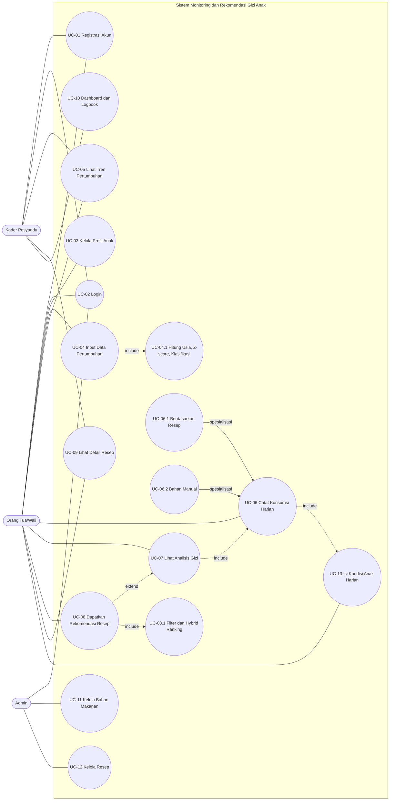
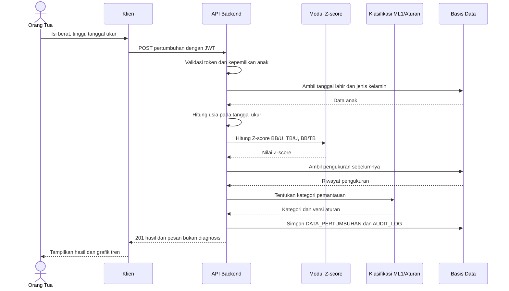
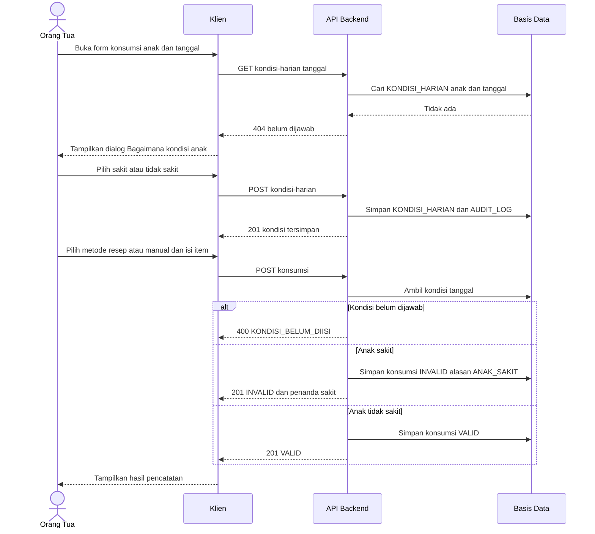
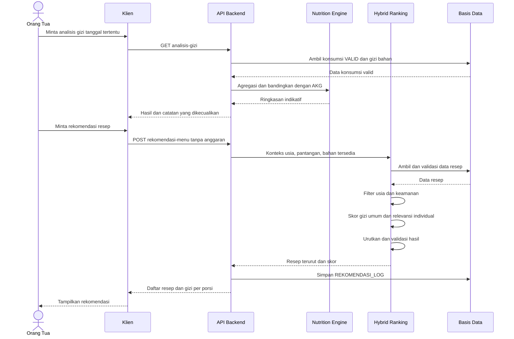
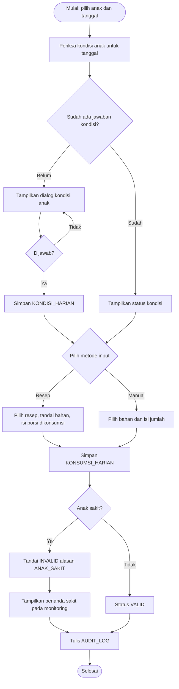
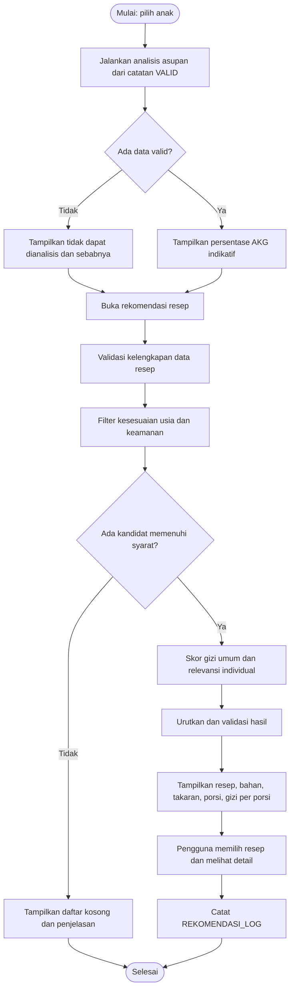
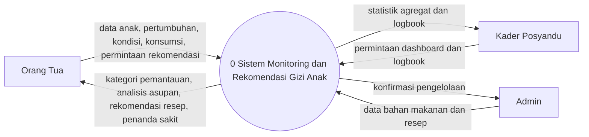
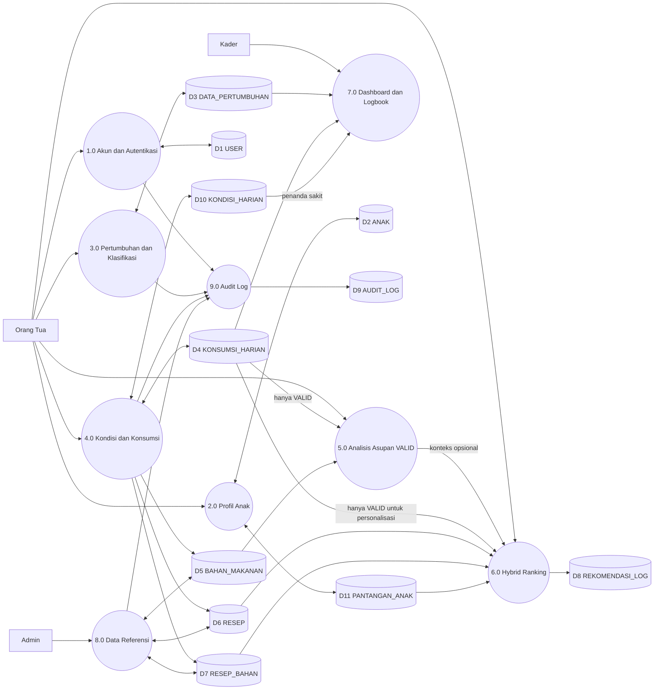
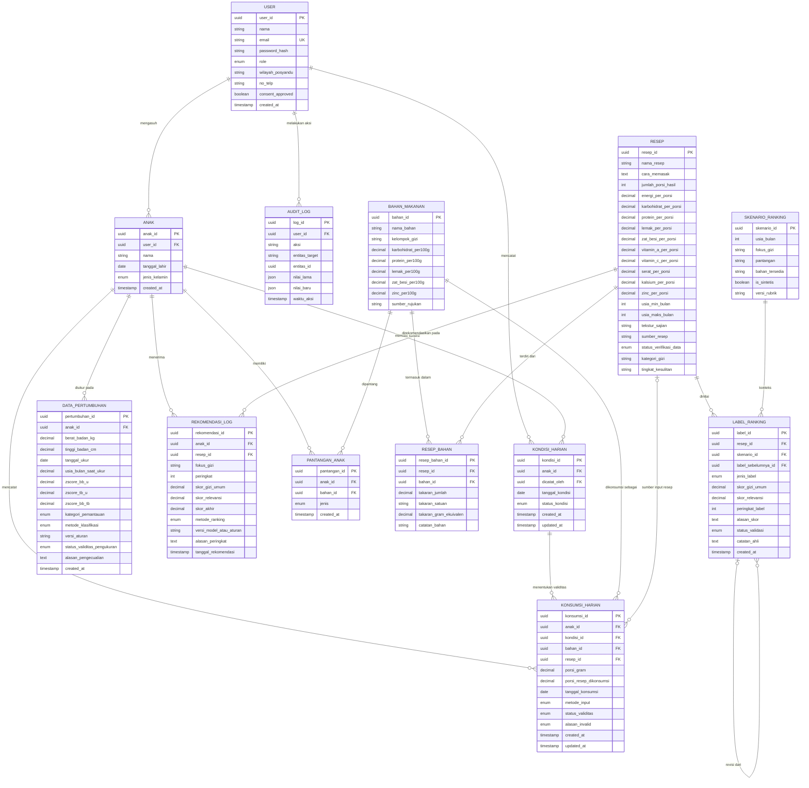

# SPESIFIKASI KEBUTUHAN PERANGKAT LUNAK (SKPL)
## Sistem Monitoring dan Rekomendasi Gizi Anak untuk Pencegahan Stunting

- Dokumen No.: SKPL-SGA-01
- Versi: 2.0 (Draft Revisi — belum divalidasi ahli)
- Tahun: 2026
- Tanggal revisi: 11 Oktober 2026

---

# RIWAYAT REVISI DAN CARA MEMBACA DOKUMEN

| **Versi** | **Tanggal** | **Status** | **Keterangan** |
|---|---|---|---|
| 1.0 | 2026 | Baseline | SKPL awal: rule-based nutrition engine, rekomendasi menu berbasis bahan dan anggaran, input konsumsi per bahan. |
| 2.0 | 11 Oktober 2026 | Draft revisi | Revisi ML #1 (replikasi kriteria pertumbuhan), ML #2 (hybrid recipe ranking tanpa harga), input konsumsi dua metode, survei kondisi anak harian, penyesuaian basis data, API, use case, dan test plan. |

**Cara membaca dokumen ini.**

1.  Dokumen ini adalah **SKPL versi 1.0 yang direvisi**, bukan dokumen baru. Struktur BAB I–VIII dipertahankan.
2.  Penanda **[BARU]** berarti bagian atau persyaratan baru pada v2.0. Penanda **[REVISI]** berarti bagian lama yang diubah. Bagian tanpa penanda dipertahankan dari v1.0.
3.  Seluruh diagram (use case, sequence, activity, DFD, ERD, arsitektur) disajikan **dalam bentuk teks** (tabel dan kode Mermaid/ASCII) tanpa gambar, agar dapat didesain ulang pada aplikasi lain. Kode Mermaid dapat ditempel langsung ke editor yang mendukung Mermaid.
4.  Hal yang belum diputuskan atau belum divalidasi ditulis sebagai **KONF-nn** (perlu konfirmasi) dan dirangkum pada Lampiran C. Keputusan yang sudah ditetapkan ditulis sebagai **KEP-nn**.
5.  Ringkasan perubahan, daftar persyaratan baru/revisi, asumsi, dan pemeriksaan konsistensi ada pada Lampiran A–D.

**Pernyataan penting.** Dokumen ini belum divalidasi secara klinis maupun teknis. Ambang batas, kriteria kategori pemantauan, rubrik penilaian resep, dan label ranking masih menunggu validasi pihak yang kompeten (ahli gizi/tenaga kesehatan). Dokumen ini tidak menyatakan bahwa sistem memenuhi standar atau sertifikasi tertentu.

# DAFTAR ISI

- BAB I PENDAHULUAN: 1.1 Tujuan; 1.2 Ruang Lingkup; 1.3 Definisi, Akronim, dan Singkatan; 1.4 Referensi; 1.5 Deskripsi Umum Dokumen
- BAB II DESKRIPSI UMUM: 2.1 Perspektif Produk; 2.2 Fungsi Sistem; 2.3 Karakteristik Pengguna; 2.4 Batasan Sistem; 2.5 Asumsi dan Ketergantungan
- BAB III KEBUTUHAN FUNGSIONAL: 3.1 Daftar Fungsi Utama; 3.2 Detail Fungsi; 3.3 Spesifikasi Komponen Machine Learning [BARU]; 3.4 Aturan Bisnis [BARU]
- BAB IV KEBUTUHAN NON-FUNGSIONAL: 4.1 Keamanan; 4.2 Kinerja; 4.3 Keandalan; 4.4 Usability; 4.5 Kompatibilitas; 4.6 Pemeliharaan; 4.7 Integritas dan Kualitas Data [BARU]
- BAB V ANTARMUKA SISTEM: 5.1 Antarmuka Pengguna; 5.2 Perangkat Keras; 5.3 Perangkat Lunak; 5.4 Antarmuka Komunikasi (Integration Contract)
- BAB VI MODEL DAN DIAGRAM PENDUKUNG (TEKSTUAL): 6.1 Use Case; 6.2 Sequence; 6.3 Activity; 6.4 DFD; 6.5 ERD dan Kamus Data; 6.6 Arsitektur Sistem
- BAB VII BUKTI HASIL ELISITASI KEBUTUHAN PENGGUNA
- BAB VIII RENCANA PENGUJIAN (TEST PLAN)
- LAMPIRAN A Ringkasan Perubahan dan Pemetaan Dokumen Lama
- LAMPIRAN B Daftar Persyaratan Baru atau Direvisi
- LAMPIRAN C Daftar Keputusan, Asumsi, dan Hal yang Memerlukan Konfirmasi
- LAMPIRAN D Pemeriksaan Konsistensi Akhir

# BAB I PENDAHULUAN

## 1.1 Tujuan

Dokumen Spesifikasi Kebutuhan Perangkat Lunak (SKPL) ini disusun untuk mendefinisikan secara rinci kebutuhan fungsional maupun non-fungsional dari Sistem Monitoring dan Rekomendasi Gizi Anak untuk Pencegahan Stunting. Dokumen ini menjadi acuan bersama antara pengembang, pengguna (orang tua, kader posyandu, dan admin), serta pihak terkait lainnya (mitra desa/Puskesmas) dalam perancangan, pengembangan, pengujian, dan evaluasi sistem, sehingga seluruh pihak memiliki pemahaman yang sama mengenai ruang lingkup dan perilaku sistem.

Secara khusus, dokumen ini bertujuan untuk:

1.  Menjelaskan gambaran umum dan lingkup sistem yang akan dikembangkan.
2.  Mendefinisikan kebutuhan fungsional sistem secara rinci berdasarkan peran pengguna.
3.  Mendefinisikan kebutuhan non-fungsional yang mencakup keamanan, kinerja, keandalan, usability, kompatibilitas, pemeliharaan, serta integritas dan kualitas data.
4.  Mendefinisikan spesifikasi komponen machine learning (ML #1 dan ML #2) beserta batasan klaim dan rancangan evaluasinya. **[BARU]**
5.  Menjadi dasar acuan pengujian (test plan).
6.  Menjadi dokumen acuan administratif antara pengembang dan pemangku kepentingan.

## 1.2 Ruang Lingkup [REVISI]

Sistem Monitoring dan Rekomendasi Gizi Anak untuk Pencegahan Stunting (selanjutnya disebut “Sistem”) adalah aplikasi berbasis web dan mobile yang digunakan untuk:

1.  memantau pertumbuhan anak usia 12–59 bulan berdasarkan data berat badan, tinggi badan, dan tanggal pengukuran bulanan, dengan mendigitalisasi kriteria pemantauan pertumbuhan yang tervalidasi (ML #1);
2.  mencatat konsumsi harian anak, melalui dua metode: berdasarkan resep atau input bahan makanan secara manual, didahului pemeriksaan kondisi anak pada hari pencatatan;
3.  menganalisis asupan harian terhadap Angka Kecukupan Gizi (AKG) secara rule-based menggunakan catatan konsumsi yang valid;
4.  memberikan rekomendasi resep makanan baduta melalui hybrid recipe ranking (ML #2) berdasarkan kualitas gizi umum resep dan relevansi terhadap konteks individual anak;
5.  menyediakan dashboard agregat dan logbook bagi kader posyandu; serta
6.  menyediakan modul administrasi data referensi (bahan makanan dan resep) bagi admin.

Ruang lingkup sistem mencakup modul-modul berikut:

1.  Modul Autentikasi dan Manajemen Akun (registrasi, login, consent/persetujuan data).
2.  Modul Profil Anak (pendataan anak yang diasuh oleh orang tua).
3.  Modul Data Pertumbuhan (input berat/tinggi badan, penghitungan usia pada tanggal pengukuran, Z-score, dan klasifikasi pemantauan pertumbuhan — ML #1). **[REVISI]**
4.  Modul Kondisi Anak Harian (pemeriksaan kondisi anak sebelum input konsumsi). **[BARU]**
5.  Modul Konsumsi Harian dan Rule-Based Nutrition Engine (input berdasarkan resep atau manual; analisis persentase AKG dari catatan valid). **[REVISI]**
6.  Modul Rekomendasi Resep (hybrid recipe ranking — ML #2). **[REVISI]**
7.  Modul Dashboard dan Logbook Kader Posyandu (data agregat dan anonim per wilayah; logbook read-only).
8.  Modul Referensi Data Bahan Makanan dan Resep (dikelola Admin). **[REVISI]**
9.  Modul Audit Log untuk pencatatan aktivitas pengguna dan perubahan status data. **[REVISI]**

**Sistem TIDAK mencakup:** diagnosis medis klinis; penggantian pemeriksaan tenaga kesehatan; penentuan defisiensi zat gizi atau penyakit anak secara otomatis; pembuatan resep baru secara generatif; transaksi pembelian bahan makanan (bukan e-commerce); serta pencatatan harga, anggaran, atau biaya makanan dalam bentuk apa pun. **[REVISI]**

## 1.3 Definisi, Akronim, dan Singkatan [REVISI]

*Tabel 1.1 Definisi, Akronim, dan Singkatan*

| **Istilah** | **Definisi** |
|---|---|
| SKPL | Spesifikasi Kebutuhan Perangkat Lunak, dokumen definisi kebutuhan sistem. |
| ERD | Entity Relationship Diagram, diagram relasi antar entitas basis data. |
| DFD | Data Flow Diagram, diagram alir data dalam sistem. |
| API | Application Programming Interface, antarmuka komunikasi data antar aplikasi. |
| REST | Representational State Transfer, gaya arsitektur layanan web berbasis HTTP. |
| JWT | JSON Web Token, token terenkripsi untuk autentikasi dan otorisasi. |
| RBAC | Role-Based Access Control, kontrol akses berbasis peran pengguna. |
| IDOR | Insecure Direct Object Reference, kerentanan akses data lintas pengguna. |
| AKG | Angka Kecukupan Gizi, standar kebutuhan gizi harian berdasarkan usia. |
| Z-score | Nilai standar deviasi hasil pengukuran antropometri anak dibanding baku rujukan pertumbuhan. |
| BB/U (WAZ) | Berat badan menurut umur; Z-score weight-for-age. |
| TB/U (HAZ) | Tinggi/panjang badan menurut umur; Z-score height/length-for-age. |
| BB/TB (WHZ) | Berat badan menurut tinggi/panjang badan; Z-score weight-for-height/length. WHZ **bukan** BMI-for-age dan tidak boleh disamakan dengannya. **[BARU]** |
| Stunting | Kondisi gagal tumbuh pada anak akibat kekurangan gizi kronis, ditandai tinggi badan tidak sesuai usia. Penetapan status stunting adalah ranah tenaga kesehatan; sistem tidak mendiagnosis. |
| TKPI | Tabel Komposisi Pangan Indonesia, sumber data kandungan gizi bahan makanan. |
| Posyandu | Pos Pelayanan Terpadu, unit kesehatan berbasis masyarakat tingkat desa. |
| Kader | Relawan kesehatan masyarakat yang membantu kegiatan posyandu. |
| CRUD | Create, Read, Update, Delete. |
| ML #1 | Model machine learning untuk mereplikasi/mendigitalisasi kriteria pemantauan pertumbuhan yang tervalidasi. **[BARU]** |
| ML #2 | Model hybrid recipe ranking untuk mengurutkan resep yang memenuhi syarat. **[BARU]** |
| Aturan acuan | Aturan deterministik (perhitungan Z-score dan pemetaan kategori sesuai kriteria tervalidasi) yang menjadi rujukan label ML #1 dan pembanding/baseline. **[BARU]** |
| Kategori pemantauan | Tiga kategori operasional sistem: Normal/Low Risk, At Risk/Needs Monitoring, High Risk/Referral. Bukan diagnosis dan bukan kategori WHO. **[BARU]** |
| Hybrid recipe ranking | Pengurutan resep dengan menggabungkan kualitas gizi umum resep dan relevansi terhadap konteks individual anak. **[BARU]** |
| Resep per porsi | Kandungan gizi pada dataset resep dinyatakan **per satu porsi**; jumlah porsi hasil resep disimpan sebagai atribut terpisah. **[BARU]** |
| Kondisi anak harian | Status anak (sakit/tidak sakit) pada satu tanggal pencatatan. **[BARU]** |
| INVALID | Status catatan konsumsi yang dikecualikan dari analisis, perhitungan asupan, fitur/inferensi ML berbasis konsumsi, dan personalisasi. Catatan tidak dihapus. **[BARU]** |
| Asupan di bawah acuan | Hasil perbandingan asupan dengan AKG yang berada di bawah ambang aturan; bersifat indikatif dan **bukan** bukti defisiensi klinis. **[BARU]** |
| Data sintetis | Data buatan yang diberi penanda dan digunakan untuk eksperimen terpisah; bukan pengukuran nyata anak. **[BARU]** |

## 1.4 Referensi [REVISI]

1.  Dokumen Kamus Data dan ERD — Sistem Monitoring dan Rekomendasi Gizi Anak untuk Pencegahan Stunting, Versi 1.0. *Catatan: harus diselaraskan dengan sub-bab 6.5 versi 2.0 ini.*
2.  Dokumen Integration Contract (API Specification) Versi 1.0. *Catatan: harus diselaraskan dengan sub-bab 5.4 versi 2.0 ini.*
3.  World Health Organization (WHO), Child Growth Standards, sebagai baku rujukan Z-score pertumbuhan anak.
4.  Peraturan Menteri Kesehatan RI mengenai Standar Antropometri Anak.
5.  Tabel Komposisi Pangan Indonesia (TKPI) dan USDA FoodData Central sebagai sumber data kandungan gizi bahan makanan.
6.  BUKU RESEP MENU BERGIZI DAPUR SEHAT ATASI STUNTING (DASHAT) NUSANTARA (sumber dataset resep). **[BARU]** *Kerjasama Badan Kependudukan dan Keluarga Berencana Nasional (BKKBN) dan Asosiasi Institusi Perguruan Tinggi Gizi Indonesia (AIPGI) ©2022 (KONF-01).*
7.  IEEE Std 830-1998, Recommended Practice for Software Requirements Specifications, sebagai acuan format SKPL.

## 1.5 Deskripsi Umum Dokumen

Dokumen ini terdiri atas delapan bab dan empat lampiran. BAB I menjelaskan pendahuluan. BAB II menjelaskan deskripsi umum produk. BAB III memuat kebutuhan fungsional per fungsi, spesifikasi komponen machine learning, dan aturan bisnis. BAB IV memuat kebutuhan non-fungsional. BAB V menjelaskan antarmuka sistem termasuk Integration Contract API. BAB VI memuat model dan diagram pendukung dalam bentuk teks. BAB VII memuat bukti hasil elisitasi kebutuhan. BAB VIII memuat rencana pengujian. Lampiran A–D memuat ringkasan perubahan, daftar persyaratan baru/revisi, keputusan dan asumsi, serta pemeriksaan konsistensi.

# BAB II DESKRIPSI UMUM

## 2.1 Perspektif Produk

Sistem merupakan produk perangkat lunak baru (bukan pengembangan dari sistem lama) yang dibangun dengan arsitektur client-server tiga lapis (three-tier): lapisan antarmuka pengguna (klien web dan mobile), lapisan logika bisnis/layanan (REST API backend termasuk Rule-Based Nutrition Engine, komponen ML #1, dan komponen Hybrid Recipe Ranking/ML #2), serta lapisan basis data (PostgreSQL/MySQL). **[REVISI]** Sistem bersifat mandiri (standalone) namun dapat berintegrasi secara administratif dengan data rujukan gizi nasional (TKPI) maupun internasional (USDA FoodData Central) sebagai sumber data kandungan gizi bahan makanan, serta menggunakan dataset resep baduta yang bersumber dari Buku Resep Menu Bergizi Dapur Sehat Atasi Stunting (Dashat) Nusantara. Rincian arsitektur dijelaskan pada sub-bab 6.6.

## 2.2 Fungsi Sistem [REVISI]

Secara garis besar, sistem menyediakan fungsi-fungsi berikut:

1.  Registrasi dan autentikasi pengguna dengan tiga peran: orang tua, kader posyandu, dan admin.
2.  Pengelolaan profil anak (tambah, lihat, ubah) oleh orang tua, termasuk pantangan/alergi anak apabila informasinya tersedia dan fitur tersebut diaktifkan (KONF-12).
3.  Pencatatan data pertumbuhan anak (berat dan tinggi badan, tanggal pengukuran) beserta penghitungan usia pada tanggal pengukuran, Z-score (BB/U, TB/U, BB/TB), tren, dan klasifikasi kategori pemantauan sebagai replikasi kriteria tervalidasi (ML #1).
4.  Pemeriksaan kondisi anak (sakit/tidak sakit) pada tanggal pencatatan sebelum input konsumsi harian. **[BARU]**
5.  Pencatatan konsumsi harian anak melalui dua metode: berdasarkan resep atau input bahan makanan manual. **[REVISI]**
6.  Pengecualian catatan konsumsi tidak valid (anak sakit) dari analisis dengan tetap menampilkan penanda sakit pada monitoring. **[BARU]**
7.  Analisis kecukupan asupan harian secara otomatis (Rule-Based Nutrition Engine) dari catatan konsumsi valid, menghasilkan persentase AKG per zat gizi beserta status (cukup/kurang/sangat kurang) yang bersifat indikatif. **[REVISI]**
8.  Rekomendasi resep dengan hybrid recipe ranking (ML #2): resep yang tidak memenuhi syarat wajib (kesesuaian usia, keamanan) dikeluarkan lebih dulu, lalu resep yang memenuhi syarat diurutkan berdasarkan kualitas gizi umum dan relevansi individual. **[REVISI]**
9.  Penampilan detail resep: bahan, takaran, cara memasak, jumlah porsi hasil, dan kandungan gizi per porsi. **[REVISI]**
10. Dashboard agregat dan bagi kader posyandu untuk memantau distribusi kategori pemantauan pertumbuhan. **[REVISI]**
11. Logbook riwayat pertumbuhan, konsumsi, dan penanda kondisi sakit anak binaan yang dapat diakses kader secara read-only. **[REVISI]**
12. Pengelolaan data referensi bahan makanan dan resep oleh admin. **[REVISI]**
13. Pencatatan audit log atas aktivitas penting dan perubahan status data. **[REVISI]**

## 2.3 Karakteristik Pengguna

*Tabel 2.1 Karakteristik Pengguna* (aktor dan pembagian kewenangan **dipertahankan**; hak akses disesuaikan untuk fungsi baru)

| **Peran** | **Karakteristik** | **Keahlian Teknis** | **Hak Akses Utama** |
|---|---|---|---|
| Orang Tua/Wali | Pengguna utama rumah tangga yang mengasuh anak usia 12–59 bulan; mendaftar dan menginput data anak sendiri. | Dasar–menengah (pengguna smartphone umum) | CRUD data anak, pertumbuhan, konsumsi milik sendiri; mengisi kondisi anak harian; melihat analisis asupan, kategori pemantauan, dan rekomendasi resep. |
| Kader Posyandu | Relawan kesehatan tingkat desa yang membina beberapa keluarga dalam satu wilayah posyandu. | Menengah | Melihat data agregat dan logbook anak binaan (read-only), termasuk penanda kondisi sakit. |
| Admin | Pengelola sistem yang bertanggung jawab atas data referensi gizi dan pengawasan sistem. | Tinggi | CRUD data bahan makanan dan resep (termasuk status verifikasi data resep); pengawasan audit log (lihat KONF-13). |

*Catatan:* Ahli gizi/tenaga kesehatan yang meninjau kriteria dan label ML bukan aktor sistem; peran mereka adalah proses validasi proyek di luar aplikasi (lihat 3.3).

## 2.4 Batasan Sistem [REVISI]

1.  Sistem tidak menggantikan diagnosis klinis tenaga kesehatan. Kategori pemantauan dan hasil analisis bersifat indikatif, bukan diagnosis.
2.  Sistem membutuhkan koneksi internet aktif untuk seluruh fungsi utama (tidak mendukung mode offline penuh pada versi ini).
3.  Perhitungan kandungan gizi bahan mengacu pada basis data TKPI/USDA (rata-rata per 100 gram), bukan hasil uji laboratorium. Kandungan gizi resep mengacu pada nilai per porsi dari dataset resep.
4.  Rekomendasi resep bukan hasil kecerdasan buatan generatif; sistem hanya mengurutkan resep yang tersedia pada dataset. Variasi terbatas pada resep yang ada.
5.  Sistem dikembangkan dengan basis data relasional (PostgreSQL atau MySQL).
6.  ML #1 hanya mereplikasi kriteria yang telah tervalidasi; tidak menemukan pola risiko baru dan tidak boleh diklaim memprediksi risiko klinis. **[BARU]**
7.  Data konsumsi nyata dan asupan mikronutrien belum dipastikan tersedia lengkap; fitur asupan bukan syarat wajib untuk ML #1 versi awal. Data sintetis (jika digunakan) hanya untuk eksperimen terpisah. **[BARU]**
8.  Asupan di bawah acuan AKG tidak membuktikan defisiensi klinis. **[BARU]**
9.  Label sintetis ML #2 adalah rancangan awal untuk eksperimen, bukan penilaian ahli yang sudah disahkan. **[BARU]**
10. Kesesuaian setiap resep untuk seluruh kelompok usia sasaran tidak diasumsikan; harus diperiksa berdasarkan kriteria tervalidasi. **[BARU]**

## 2.5 Asumsi dan Ketergantungan [REVISI]

1.  Pengguna memiliki smartphone atau komputer dengan akses internet memadai.
2.  Data berat dan tinggi badan diinput berdasarkan pengukuran menggunakan alat terkalibrasi (timbangan/alat ukur posyandu) dan dilakukan setiap bulan.
3.  Standar rujukan pertumbuhan WHO/Kemenkes tidak berubah signifikan selama masa operasional versi ini.
4.  Data referensi kandungan gizi bahan makanan (TKPI/USDA) tersedia dan dapat diperbarui admin.
5.  Wilayah kerja kader (wilayah_posyandu) terdefinisi dan konsisten penamaannya.
6.  Infrastruktur server tersedia dan dikelola sesuai BAB IV.
7.  Buku Resep Menu Bergizi Dapur Sehat Atasi Stunting (Dashat) Nusantara tersedia dan dapat diekstrak menjadi data terstruktur (bahan, takaran, langkah, porsi, gizi per porsi). Kelengkapan dan konsistensinya harus diperiksa (KONF-01, KONF-08). **[BARU]**
8.  Kriteria pemantauan pertumbuhan, definisi kategori, serta rubrik penilaian resep akan ditetapkan/divalidasi oleh pihak yang kompeten sebelum digunakan untuk pengguna akhir. **[BARU]**
9.  Pengguna bersedia menjawab pemeriksaan kondisi anak harian dengan jujur; sistem tidak dapat memverifikasi kebenarannya. **[BARU]**

# BAB III KEBUTUHAN FUNGSIONAL

## 3.1 Daftar Fungsi Utama Sistem [REVISI]

Kebutuhan fungsional diberi kode **SKPL-F-XX** (konvensi v1.0 dipertahankan). Kode F-01 s.d. F-12 tetap seperti v1.0 (nama dapat direvisi). Kode baru F-13 s.d. F-16 ditambahkan; F-13 dan F-14 sebelumnya telah dirujuk pada BAB VII–VIII v1.0 dan ruang lingkup 2.2 v1.0, tetapi belum didefinisikan pada BAB III. Persyaratan rinci diberi sub-ID **SKPL-F-XX.n**.

*Tabel 3.1 Daftar Fungsi Utama Sistem*

| **Kode** | **Nama Fungsi** | **Aktor** | **Status** |
|---|---|---|---|
| SKPL-F-01 | Registrasi Akun dan Persetujuan Pengguna | Orang Tua, Kader | Dipertahankan |
| SKPL-F-02 | Login/Autentikasi Pengguna | Orang Tua, Kader, Admin | Dipertahankan |
| SKPL-F-03 | Kelola Profil Anak (Tambah/Lihat/Ubah) | Orang Tua | Direvisi (pantangan/alergi opsional) |
| SKPL-F-04 | Input Data Pertumbuhan, Z-score, dan Klasifikasi Pemantauan (ML #1) | Orang Tua | Direvisi |
| SKPL-F-05 | Lihat Riwayat/Tren Pertumbuhan Anak | Orang Tua, Kader | Direvisi (kategori pemantauan, tren) |
| SKPL-F-06 | Catat Konsumsi Harian (Berdasarkan Resep atau Manual) | Orang Tua | Direvisi |
| SKPL-F-07 | Analisis Kecukupan Asupan Otomatis (Rule-Based, hanya data valid) | Orang Tua | Direvisi |
| SKPL-F-08 | Rekomendasi Resep Hybrid Ranking (ML #2) | Orang Tua | Direvisi (anggaran dihapus) |
| SKPL-F-09 | Lihat Detail Resep | Orang Tua, Kader | Direvisi (porsi dan gizi per porsi) |
| SKPL-F-10 | Dashboard Pemantauan Kader Posyandu | Kader | Direvisi |
| SKPL-F-11 | Kelola Data Referensi Bahan Makanan | Admin | Direvisi (harga dihapus) |
| SKPL-F-12 | Kelola Data Referensi Resep | Admin | Direvisi (harga dihapus; porsi, gizi per porsi) |
| SKPL-F-13 | Lihat Logbook Anak Binaan (read-only) | Kader | Diformalkan dari v1.0, direvisi |
| SKPL-F-14 | Pencatatan Audit Log | Sistem | Diformalkan dari v1.0, direvisi |
| SKPL-F-15 | Pemeriksaan Kondisi Anak Harian | Orang Tua | **[BARU]** |
| SKPL-F-16 | Pengecualian Konsumsi Tidak Valid dan Penandaan Status Sakit pada Monitoring | Sistem; dilihat Orang Tua, Kader | **[BARU]** |

## 3.2 Detail Fungsi

### SKPL-F-01 Registrasi Akun dan Persetujuan Pengguna

| **Atribut** | **Deskripsi** |
|---|---|
| Precondition | Pengguna belum memiliki akun terdaftar. |
| Input | Nama, email, password, role (orang_tua/kader), wilayah_posyandu (wajib jika kader), no_telp, persetujuan (consent_approved). |
| Proses | Sistem memvalidasi format email dan kekuatan password, memastikan email belum terdaftar, mewajibkan consent_approved = true, melakukan hashing password, lalu menyimpan data pengguna baru. |
| Output | Akun baru tersimpan beserta user_id unik dan role. |
| Postcondition | Pengguna dapat login. |
| Exception Handling | Jika email sudah terdaftar atau consent_approved = false, sistem menolak (HTTP 400). |

### SKPL-F-02 Login/Autentikasi Pengguna

| **Atribut** | **Deskripsi** |
|---|---|
| Precondition | Pengguna memiliki akun terdaftar dan terverifikasi. |
| Input | Email dan password. |
| Proses | Sistem memverifikasi password terhadap password_hash, lalu menerbitkan sesi/token autentikasi. |
| Output | Token, role, dan user_id dikembalikan ke klien. |
| Postcondition | Pengguna dapat mengakses endpoint yang memerlukan otorisasi. |
| Exception Handling | Kredensial salah: HTTP 401 tanpa token. |

### SKPL-F-03 Kelola Profil Anak [REVISI]

| **Atribut** | **Deskripsi** |
|---|---|
| Precondition | Pengguna berperan orang tua dan telah login. |
| Input | Nama anak, tanggal lahir, jenis kelamin (tambah); anak_id (lihat/ubah). **Opsional:** daftar pantangan/alergi anak yang diketahui, berupa referensi bahan makanan (hanya jika fitur diaktifkan — KONF-12). |
| Proses | Sistem memvalidasi kepemilikan (user_id token = pemilik anak) sebelum baca/ubah, menghitung usia anak dalam bulan dari tanggal_lahir untuk memastikan berada pada rentang target 12–59 bulan pada saat pendaftaran. |
| Output | Profil anak tersimpan/diperbarui. |
| Postcondition | Anak dapat menjadi rujukan pencatatan pertumbuhan, kondisi harian, dan konsumsi. |
| Exception Handling | Mengubah data anak milik orang lain: HTTP 403 (mencegah IDOR). |

SKPL-F-03.1 **[BARU]** Informasi pantangan/alergi bersifat opsional; bila tidak diisi, sistem tidak boleh menganggap anak tidak memiliki alergi, melainkan menampilkan catatan bahwa pemeriksaan pantangan tidak dilakukan.

### SKPL-F-04 Input Data Pertumbuhan, Z-score, dan Klasifikasi Pemantauan (ML #1) [REVISI]

| **Atribut** | **Deskripsi** |
|---|---|
| Precondition | Profil anak telah terdaftar (tanggal_lahir dan jenis_kelamin tersedia). |
| Input | Berat badan (kg), tinggi/panjang badan (cm), tanggal pengukuran (tanggal_ukur). |
| Proses | \(1\) Sistem menghitung **usia anak pada tanggal_ukur** dari tanggal_lahir dan tanggal_ukur, bukan dari tanggal input atau tanggal sistem digunakan. (2) Sistem menghitung Z-score BB/U, TB/U, dan BB/TB sesuai usia, jenis kelamin, dan standar pertumbuhan yang berlaku. (3) Sistem menghitung tren dari pengukuran bulanan sebelumnya (definisi tren menunggu validasi ahli, KONF-04). (4) Sistem menentukan kategori pemantauan (Normal/Low Risk, At Risk/Needs Monitoring, High Risk/Referral) sesuai kriteria tervalidasi (3.3.1). |
| Output | Usia saat ukur, tiga nilai Z-score, tren, kategori pemantauan, dan pesan arahan (bukan diagnosis) dikembalikan dan disimpan pada DATA_PERTUMBUHAN. |
| Postcondition | Riwayat pertumbuhan bertambah dan dapat ditampilkan sebagai grafik tren. |
| Exception Handling | Nilai di luar rentang fisiologis wajar: peringatan validasi sebelum simpan. Usia pada tanggal_ukur di luar 12–59 bulan: peringatan dan klasifikasi tidak dijalankan sampai kebijakan ditetapkan (KONF-05). |

Persyaratan rinci:

- SKPL-F-04.1 **[BARU]** Usia dihitung dari tanggal_lahir dan tanggal_ukur. Pengukuran yang diinput belakangan harus memakai usia pada tanggal ukurnya.
- SKPL-F-04.2 **[BARU]** Indikator BB/U, TB/U, dan BB/TB dihitung dan ditampilkan sebagai indikator terpisah. WHZ tidak boleh dihitung/diberi label sebagai BMI-for-age; indikator tidak diperlakukan memiliki makna klinis yang sama.
- SKPL-F-04.3 **[BARU]** Dasar perhitungan Z-score, batas kategori, dan definisi label wajib merujuk standar yang divalidasi pihak kompeten; ambang tidak ditetapkan sepihak oleh pengembang (KONF-02).
- SKPL-F-04.4 **[BARU]** Pada kategori At Risk dan High Risk, sistem mengarahkan pengguna untuk berkonsultasi dengan kader atau tenaga kesehatan sesuai alur yang disepakati (KONF-03). Sistem tidak menampilkan diagnosis otomatis.
- SKPL-F-04.5 **[BARU]** Status sakit anak pada suatu tanggal tidak otomatis membuat pengukuran berat/tinggi menjadi tidak valid (BR-07).

### SKPL-F-05 Lihat Riwayat/Tren Pertumbuhan Anak [REVISI]

| **Atribut** | **Deskripsi** |
|---|---|
| Precondition | Terdapat minimal satu catatan data pertumbuhan anak. |
| Input | anak_id. |
| Proses | Sistem mengambil riwayat DATA_PERTUMBUHAN anak diurutkan menurut tanggal_ukur. |
| Output | Daftar riwayat (berat, tinggi, usia saat ukur, Z-score, kategori pemantauan) untuk grafik tren. |
| Postcondition | Pengguna dapat memantau perkembangan anak dari waktu ke waktu. |
| Exception Handling | Belum ada data: daftar kosong dengan pesan informatif. |

### SKPL-F-06 Catat Konsumsi Harian Anak (Berdasarkan Resep atau Manual) [REVISI]

| **Atribut** | **Deskripsi** |
|---|---|
| Precondition | Profil anak dan data referensi bahan makanan/resep tersedia; **pemeriksaan kondisi anak (SKPL-F-15) untuk tanggal terkait telah dijawab.** |
| Input | Tanggal konsumsi; metode input (RESEP atau MANUAL). **Metode RESEP:** resep_id, jumlah porsi yang dikonsumsi anak, serta penandaan bahan yang digunakan/dikonsumsi dari daftar bahan resep. **Metode MANUAL:** daftar item (bahan_id, jumlah dengan satuan kg atau gram yang dikonversi ke gram). |
| Proses | Sistem memvalidasi bahan_id/resep_id, menyimpan satu atau beberapa baris KONSUMSI_HARIAN dengan metode_input yang dapat dibedakan, mengaitkannya dengan kondisi anak pada tanggal tersebut, dan menetapkan status_validitas sesuai SKPL-F-16. |
| Output | Catatan konsumsi tersimpan beserta status_validitas (VALID/INVALID) dan metode_input. |
| Postcondition | Catatan VALID menjadi masukan analisis asupan (SKPL-F-07); catatan INVALID tidak. |
| Exception Handling | bahan_id/resep_id tidak ditemukan: HTTP 400. Kondisi anak belum dijawab untuk tanggal tersebut: simpan ditolak (KONDISI_BELUM_DIISI). |

Persyaratan rinci:

- SKPL-F-06.1 **[BARU]** Input berdasarkan resep: pengguna memilih resep dari daftar; sistem menampilkan daftar bahan beserta takarannya; pengguna menandai/menyesuaikan bahan yang benar-benar digunakan atau dikonsumsi. Pemilihan resep tidak otomatis berarti seluruh bahan dikonsumsi anak.
- SKPL-F-06.2 **[BARU]** Input manual: pengguna memilih bahan dari referensi BAHAN_MAKANAN dan mengisi jumlah (dropdown kg/gram, dipertahankan dari v1.0). Pencatatan harga/biaya tidak disediakan.
- SKPL-F-06.3 **[BARU]** Kedua metode terintegrasi pada tabel KONSUMSI_HARIAN yang sama dan dibedakan oleh atribut metode_input untuk audit dan pengolahan data.
- SKPL-F-06.4 **[BARU]** Jumlah porsi hasil resep tidak diasumsikan sama dengan jumlah yang dimakan anak dalam sekali makan (BR-05). Rumus konversi bahan resep ke gram dikonsumsi dijelaskan pada 3.4 (BR-06) dan perlu dikonfirmasi (KONF-09).

### SKPL-F-07 Analisis Kecukupan Asupan Otomatis (Rule-Based Nutrition Engine) [REVISI]

| **Atribut** | **Deskripsi** |
|---|---|
| Precondition | Tersedia catatan konsumsi **berstatus VALID** pada tanggal yang dianalisis serta data usia anak. |
| Input | anak_id dan tanggal analisis. |
| Proses | Sistem hanya mengambil KONSUMSI_HARIAN berstatus VALID, mengagregasi karbohidrat, protein, lemak, zat besi, dan zinc (jumlah gram × nilai per 100 g bahan), membandingkan dengan AKG rujukan sesuai usia dan jenis kelamin, lalu menetapkan status per zat gizi (cukup/kurang/sangat_kurang) berdasarkan ambang rule-based yang dapat dikonfigurasi. |
| Output | Persentase AKG per zat gizi, status (bersifat indikatif), daftar tanggal/catatan yang dikecualikan beserta alasannya, dan indikator rekomendasi_tersedia. |
| Postcondition | Pengguna dapat melanjutkan ke rekomendasi resep (SKPL-F-08). |
| Exception Handling | Tidak ada data konsumsi: status “tidak dapat dianalisis – belum ada data”. Seluruh catatan tanggal itu INVALID karena anak sakit: status “tidak dapat dianalisis – anak tercatat sakit” (dibedakan dari belum ada data; tidak dianggap konsumsi nol). |

- SKPL-F-07.1 **[BARU]** Hasil “kurang/sangat_kurang” diberi label sebagai asupan di bawah acuan AKG, bukan defisiensi.
- SKPL-F-07.2 **[BARU]** Catatan INVALID tidak ikut dalam agregasi, tren asupan, fitur ML berbasis konsumsi, maupun personalisasi.

### SKPL-F-08 Rekomendasi Resep Hybrid Ranking (ML #2) [REVISI]

| **Atribut** | **Deskripsi** |
|---|---|
| Precondition | Anak terdaftar dan dataset resep tersedia. Hasil analisis asupan (SKPL-F-07) bersifat opsional sebagai konteks (v1.0 mensyaratkan adanya defisiensi; lihat Lampiran A). |
| Input | anak_id; opsional: daftar bahan_id yang tersedia di rumah (hanya jika fitur ketersediaan bahan digunakan — KONF-10); opsional: jumlah rekomendasi (top-K). **Tidak ada input anggaran.** |
| Proses | Alur 9 langkah pada 3.3.2: ambil resep, validasi data, tentukan konteks, periksa usia dan keamanan, keluarkan resep tidak memenuhi syarat wajib, nilai kualitas gizi umum dan relevansi individual, urutkan, validasi hasil, tampilkan. |
| Output | Daftar resep terurut beserta skor komponen, alasan peringkat singkat, bahan, takaran, cara memasak, jumlah porsi hasil resep, dan kandungan gizi per porsi. Setiap rekomendasi dicatat pada REKOMENDASI_LOG. |
| Postcondition | Riwayat rekomendasi tersimpan untuk evaluasi dan pelaporan. |
| Exception Handling | Tidak ada resep memenuhi syarat: daftar kosong dengan penjelasan(Tidak ada resep yang cocok). Anak tercatat sakit pada tanggal permintaan: ditampilkan peringatan dan anjuran menghubungi tenaga kesehatan; konsumsi INVALID tidak dipakai untuk personalisasi (KONF-07). |

### SKPL-F-09 Lihat Detail Resep [REVISI]

| **Atribut** | **Deskripsi** |
|---|---|
| Precondition | resep_id valid tersedia. |
| Input | resep_id. |
| Proses | Sistem mengambil resep beserta RESEP_BAHAN (bahan dan takaran bersatuan sesuai sumber), langkah pembuatan, jumlah porsi hasil resep, dan kandungan gizi per porsi (energi, karbohidrat, protein, lemak, zat besi, vitamin A, vitamin C, serat, kalsium, zinc), serta rentang usia dan status verifikasi data. |
| Output | Detail resep lengkap. **Tidak memuat estimasi biaya.** |
| Postcondition | Pengguna dapat mengikuti instruksi memasak. |
| Exception Handling | resep_id tidak ditemukan: HTTP 404. |

### SKPL-F-10 Dashboard Pemantauan Kader Posyandu [REVISI]

| **Atribut** | **Deskripsi** |
|---|---|
| Precondition | Pengguna berperan kader dengan wilayah_posyandu terdaftar. |
| Input | Data pertumbuhan dan kategori pemantauan seluruh anak binaan di wilayah kader. |
| Proses | Sistem mengagregasi data anak binaan dan menyajikan distribusi kategori pemantauan serta grafik. Agregasi asupan hanya memakai catatan VALID. |
| Output | Dashboard visual (distribusi kategori pemantauan, grafik pertumbuhan). |
| Postcondition | Kader dapat memakai data sebagai pendukung evaluasi bulanan. |
| Exception Handling | Akses wilayah lain: HTTP 403. |

### SKPL-F-11 Kelola Data Referensi Bahan Makanan [REVISI]

| **Atribut** | **Deskripsi** |
|---|---|
| Precondition | Pengguna berperan admin. |
| Input | nama_bahan, kelompok_gizi, kandungan gizi per 100 g (karbohidrat, protein, lemak, zat besi, zinc), sumber_rujukan. **(estimasi_harga_per100g dihapus.)** |
| Proses | CRUD pada BAHAN_MAKANAN dengan validasi nilai gizi tidak negatif. |
| Output | Data referensi ter-update untuk modul konsumsi, resep, dan analisis. |
| Postcondition | Perubahan berlaku pada perhitungan berikutnya. |
| Exception Handling | Non-admin: HTTP 403. |

### SKPL-F-12 Kelola Data Referensi Resep [REVISI]

| **Atribut** | **Deskripsi** |
|---|---|
| Precondition | Pengguna berperan admin. |
| Input | nama_resep, langkah pembuatan, daftar bahan (bahan_id, takaran, satuan), **jumlah_porsi_hasil**, **kandungan gizi per porsi** (energi, karbohidrat, protein, lemak, zat besi, vitamin A, vitamin C, serat, kalsium, zinc) beserta satuannya sesuai sumber, rentang usia sasaran, tekstur sajian, sumber resep, status verifikasi data, tingkat_kesulitan (opsional), kategori_gizi (opsional). **(porsi_saji dinamai ulang menjadi jumlah_porsi_hasil; estimasi biaya dihapus.)** |
| Proses | CRUD pada RESEP dan RESEP_BAHAN. Sistem **tidak** menghitung ulang atau membagi nilai gizi per porsi dengan jumlah porsi hasil (BR-04). Data dengan satuan/nilai tidak jelas ditandai PERLU_VERIFIKASI. |
| Output | Data resep ter-update dan siap dipakai Hybrid Recipe Ranking bila memenuhi kelengkapan dan status verifikasi (KONF-08). |
| Postcondition | Resep yang lolos validasi dapat menjadi kandidat rekomendasi. |
| Exception Handling | Non-admin: HTTP 403. Nilai gizi negatif atau satuan kosong: ditolak. |

### SKPL-F-13 Lihat Logbook Anak Binaan (read-only) [REVISI]

| **Atribut** | **Deskripsi** |
|---|---|
| Precondition | Pengguna berperan kader; anak berada pada wilayah_posyandu kader. |
| Input | anak_id. |
| Proses | Sistem menampilkan riwayat pertumbuhan, catatan konsumsi (beserta metode_input dan status_validitas), dan penanda kondisi sakit per tanggal. Kader tidak memiliki hak ubah/hapus. |
| Output | Logbook read-only. Tanggal anak sakit menampilkan label: “Anak tercatat sedang sakit pada tanggal ini — data konsumsi tidak digunakan dalam analisis.” |
| Postcondition | Kader memperoleh konteks tanpa dapat memodifikasi data. |
| Exception Handling | Anak di luar wilayah: HTTP 403. |

### SKPL-F-14 Pencatatan Audit Log [REVISI]

| **Atribut** | **Deskripsi** |
|---|---|
| Precondition | Pengguna melakukan aksi penting (login, ubah data, perubahan status). |
| Input | user_id, aksi, entitas target, nilai lama/baru untuk perubahan status. |
| Proses | Sistem mencatat secara asinkron ke AUDIT_LOG, termasuk perubahan status kondisi anak dan perubahan status_validitas konsumsi. |
| Output | Jejak audit tersimpan. |
| Postcondition | Perubahan status dapat ditelusuri. |
| Exception Handling | Kegagalan pencatatan tidak menggagalkan transaksi utama, tetapi dicatat sebagai galat sistem. |

### SKPL-F-15 Pemeriksaan Kondisi Anak Harian [BARU]

| **Atribut** | **Deskripsi** |
|---|---|
| Precondition | Orang tua login, anak dipilih, dan akan mencatat konsumsi untuk suatu tanggal. |
| Input | anak_id, tanggal pencatatan, status_kondisi (SAKIT atau TIDAK_SAKIT). |
| Proses | Sebelum form konsumsi dapat diisi/disimpan, sistem menampilkan pop-up/dialog singkat berisi pertanyaan “Bagaimana kondisi anak hari ini?” (untuk tanggal mundur: “…pada tanggal {tanggal}?”) dengan pilihan minimal “Anak sedang sakit” dan “Anak tidak sedang sakit”. Jawaban disimpan bersama tanggal pencatatan dan identitas anak, dengan kontrol akses RBAC. |
| Output | Catatan KONDISI_HARIAN untuk (anak, tanggal). |
| Postcondition | Form konsumsi dapat dilanjutkan; status validitas konsumsi ditetapkan sesuai jawaban. |
| Exception Handling | Pop-up ditutup tanpa jawaban: konsumsi tidak dapat disimpan; kondisi tidak otomatis dianggap sehat. |

- SKPL-F-15.1 Pemeriksaan berlaku per tanggal pencatatan; status sakit hari ini tidak berlaku untuk hari lain.
- SKPL-F-15.2 Label dan rincian pilihan dapat disesuaikan pada perancangan antarmuka, tetapi fungsi pemeriksaan harus tetap ada.
- SKPL-F-15.3 Apabila (anak, tanggal) sudah memiliki jawaban, sistem menampilkan status tersebut dan memperbolehkan koreksi oleh pemilik; koreksi dicatat pada audit log dan memicu evaluasi ulang status_validitas (KONF-06).

### SKPL-F-16 Pengecualian Konsumsi Tidak Valid dan Penandaan Status Sakit pada Monitoring [BARU]

| **Atribut** | **Deskripsi** |
|---|---|
| Precondition | Tersedia jawaban kondisi anak untuk tanggal terkait. |
| Input | status_kondisi dan catatan KONSUMSI_HARIAN pada tanggal tersebut. |
| Proses | Jika SAKIT: sistem (1) menyimpan status kondisi; (2) menandai seluruh KONSUMSI_HARIAN tanggal itu sebagai INVALID dengan alasan ANAK_SAKIT; (3) mengecualikannya dari perhitungan konsumsi valid, fitur/inferensi ML berbasis konsumsi, personalisasi rekomendasi, serta agregasi dan tren asupan; (4) tetap menampilkan penanda sakit pada halaman monitoring. Jika TIDAK_SAKIT: catatan diproses sebagai VALID bila lolos pemeriksaan kelengkapan lain. |
| Output | status_validitas pada setiap catatan, penanda sakit pada monitoring. |
| Postcondition | Status sakit tetap dapat dilihat meskipun konsumsi dikecualikan; data tidak dihapus dan tidak diubah menjadi nol. |
| Exception Handling | Kondisi belum dijawab: tidak ada penetapan status; penyimpanan konsumsi ditolak (BR-09). |

## 3.3 Spesifikasi Komponen Machine Learning [BARU]

### 3.3.1 ML #1 — Replikasi Kriteria Pemantauan Pertumbuhan

**Tujuan (KEP-01).** ML #1 dirancang untuk mereplikasi atau mendigitalisasi kriteria pemantauan pertumbuhan berdasarkan aturan dan standar pertumbuhan yang tervalidasi. ML #1 tidak ditujukan untuk menemukan pola risiko baru, tidak membuat klaim penemuan ilmiah, dan tidak menggantikan penilaian tenaga kesehatan.

| **ID** | **Persyaratan** |
|---|---|
| SKPL-ML1-01 | Data masukan: tanggal lahir, jenis kelamin, berat badan bulanan, tinggi badan bulanan, tanggal pengukuran. |
| SKPL-ML1-02 | Usia dihitung pada tanggal pengukuran berdasarkan tanggal lahir dan tanggal pengukuran. Metode penghitungan (bulan penuh atau desimal) mengikuti standar dan divalidasi ahli (KONF-04). |
| SKPL-ML1-03 | Indikator yang ditinjau sesuai relevansi: BB/U (WAZ), TB/U (HAZ), BB/TB (WHZ), dan tren pengukuran bulanan. WHZ tidak disamakan dengan BMI-for-age. |
| SKPL-ML1-04 | Dasar Z-score, batas kategori, dan definisi label merujuk standar yang sesuai dan divalidasi pihak kompeten. Tidak ada ambang klinis yang ditetapkan sepihak. |
| SKPL-ML1-05 | Kategori keluaran: Normal/Low Risk, At Risk/Needs Monitoring, High Risk/Referral. Ini adalah rancangan kategori sistem, bukan diagnosis WHO. Definisi dan pemetaan final menunggu validasi (KONF-02). |
| SKPL-ML1-06 | Respons sistem per kategori: Normal/Low Risk — tampilkan hasil dan anjuran pemantauan rutin; At Risk — tampilkan hasil dan anjuran pemantauan lebih dekat serta konsultasi dengan kader/tenaga kesehatan; High Risk/Referral — tampilkan hasil dan anjuran segera berkonsultasi dengan kader/tenaga kesehatan sesuai alur rujukan. Teks pesan dan alur final menunggu persetujuan (KONF-03). Sistem tidak menampilkan diagnosis otomatis. |
| SKPL-ML1-07 | Karena tujuan adalah replikasi, model dibandingkan dengan **aturan acuan** yang menghasilkan label. |
| SKPL-ML1-08 | Pembagian data latih/uji menghindari kebocoran data; karena satu anak memiliki banyak pengukuran bulanan, pemisahan dilakukan **berdasarkan anak** (seluruh pengukuran satu anak berada pada satu sisi). |
| SKPL-ML1-09 | Evaluasi melaporkan kesesuaian dengan label aturan acuan (mis. confusion matrix dan metrik per kelas yang dipilih setelah distribusi kelas diketahui), kualitas data, dan keterbatasan model, termasuk perilaku di sekitar batas kategori. |
| SKPL-ML1-10 | Dilarang mengklaim bahwa model menemukan pola baru atau terbukti memprediksi risiko klinis hanya karena mampu meniru aturan. |
| SKPL-ML1-11 | Fitur asupan/konsumsi **bukan** syarat wajib ML #1 versi awal. Apabila nanti digunakan, hanya catatan VALID dan data nyata yang terverifikasi. |
| SKPL-ML1-12 | Data sintetis (jika digunakan) wajib diberi penanda, dipisahkan dari data nyata, digunakan untuk eksperimen terpisah, dan tidak dianggap pengukuran nyata. Asupan rendah dari catatan makanan tidak membuktikan defisiensi klinis. |
| SKPL-ML1-13 | Aturan acuan tetap tersedia sebagai pembanding/baseline. Komponen mana yang menghasilkan kategori pada tampilan pengguna akhir (aturan acuan atau model) harus diputuskan (KONF-14); usulan sementara: aturan acuan digunakan untuk tampilan pengguna sampai model lolos evaluasi dan validasi. |
| SKPL-ML1-14 | Himpunan fitur model (mentah vs Z-score) harus didefinisikan; bila Z-score menjadi fitur sementara label adalah fungsi deterministik darinya, laporan evaluasi harus menyatakan bahwa kesesuaian bukan bukti validitas klinis (KONF-15). |

### 3.3.2 ML #2 — Hybrid Recipe Ranking

**Tujuan (KEP-02).** ML #2 mengurutkan resep yang layak dipertimbangkan dengan menggabungkan (1) kualitas gizi umum resep dan (2) relevansi terhadap konteks individual anak, berdasarkan data resep, konteks rekomendasi, dan kriteria yang disepakati serta divalidasi ahli. ML #2 bukan sistem generatif dan hanya memakai resep yang tersedia pada dataset.

**Dataset resep.** Bersumber dari dokumen PDF resep baduta (bahan, takaran, cara memasak, informasi porsi, kandungan gizi). Kesesuaian usia, tekstur, bahan, keamanan makanan, dan cara penyajian harus diperiksa berdasarkan kriteria tervalidasi; tidak diasumsikan sesuai untuk semua kelompok usia.

**Atribut resep yang dipertahankan:** identitas resep; nama resep; daftar bahan beserta takaran dan satuan; langkah pembuatan; jumlah porsi hasil resep; per porsi: energi, karbohidrat, protein, lemak, zat besi, vitamin A, vitamin C, serat, kalsium, zinc. Satuan harus dipertahankan dan diverifikasi; satuan/nilai yang belum jelas ditandai PERLU_VERIFIKASI.

**Konteks individual yang dapat dipertimbangkan:** usia dan kesesuaian resep; aspek gizi yang perlu diperhatikan berdasarkan aturan tervalidasi; pantangan/alergi yang diketahui (jika tersedia); ketersediaan bahan (jika fitur digunakan dan datanya dikumpulkan); informasi sajian untuk membandingkan kandungan gizi. Hasil antropometri tidak otomatis membuktikan kekurangan zat gizi tertentu; hubungan antara data pertumbuhan dan prioritas rekomendasi harus ditetapkan melalui aturan tervalidasi (KONF-11).

**Alur filter dan ranking (9 langkah):**

1.  Mengambil data resep dari dataset.
2.  Memvalidasi kelengkapan dan konsistensi data resep.
3.  Menentukan konteks rekomendasi yang relevan.
4.  Memeriksa kesesuaian usia dan persyaratan keamanan.
5.  Mengeluarkan resep yang tidak memenuhi persyaratan wajib dari kandidat.
6.  Menilai kualitas gizi umum dan relevansi individual dari resep yang memenuhi syarat.
7.  Mengurutkan kandidat dengan pendekatan ranking.
8.  Memvalidasi hasil rekomendasi.
9.  Menampilkan resep beserta bahan, takaran, cara memasak, jumlah porsi, dan gizi per porsi.

| **ID** | **Persyaratan** |
|---|---|
| SKPL-ML2-01 | Pendekatan hybrid: skor kualitas gizi umum (tidak bergantung anak) dan skor relevansi individual digabung menjadi skor akhir. Bobot dan formula penggabungan ditetapkan bersama ahli (KONF-11); tidak ditetapkan sepihak. |
| SKPL-ML2-02 | Persyaratan wajib (kesesuaian usia, keamanan, kelengkapan data) diterapkan sebagai **filter sebelum penilaian**. Nilai gizi tinggi tidak boleh menutupi pelanggaran keamanan atau ketidaksesuaian usia. |
| SKPL-ML2-03 | **Harga, anggaran, biaya per porsi, batas anggaran, atau optimasi berdasarkan harga tidak menjadi fitur, parameter, atau kriteria ranking** (KEP-03). |
| SKPL-ML2-04 | Kandungan gizi disimpan per porsi sesuai sumber, jumlah porsi hasil resep disimpan sebagai atribut terpisah, dan nilai per porsi tidak dibagi dua kali dengan jumlah porsi hasil (BR-04). |
| SKPL-ML2-05 | Label sintetis tahap 1: menyusun rubrik penilaian dan aturan pemberian label sintetis yang transparan; mendokumentasikan alasan skor dan komponen penilaian; label dipakai sebagai rancangan awal eksperimen, bukan label klinis/penilaian ahli yang disahkan. |
| SKPL-ML2-06 | Tahap 2: rubrik dan contoh label dikonsultasikan kepada ahli yang berkolaborasi; ahli meninjau definisi kualitas gizi umum, relevansi individual, kesesuaian usia, keamanan, dan urutan resep; persetujuan, revisi, penolakan, atau bagian yang perlu dibahas didokumentasikan; riwayat label sintetis awal dan label setelah validasi disimpan. |
| SKPL-ML2-07 | Label tidak boleh dinyatakan tervalidasi sebelum peninjauan benar-benar dilakukan. |
| SKPL-ML2-08 | Evaluasi mencakup baseline ranking berbasis aturan yang transparan. Model kandidat dipilih setelah jumlah dan struktur data diketahui. Metrik ranking yang sesuai, mis. NDCG@K, dan perbandingan dengan penilaian ahli bila tersedia. |
| SKPL-ML2-09 | Dilarang mengklaim model lebih baik daripada aturan hanya karena mampu meniru label sintetis yang dihasilkan aturan yang sama. |
| SKPL-ML2-10 | Hanya catatan konsumsi VALID yang boleh dipakai untuk personalisasi berbasis konsumsi; catatan INVALID dikecualikan. |
| SKPL-ML2-11 | Resep berstatus PERLU_VERIFIKASI tidak menjadi kandidat sampai diverifikasi (usulan sementara, KONF-08). |
| SKPL-ML2-12 | Sistem tidak menyatakan secara medis bahwa suatu resep sesuai untuk anak yang sedang sakit; kebijakan tampilan saat anak sakit mengikuti KONF-07. |

## 3.4 Aturan Bisnis [BARU]

| **ID** | **Aturan** |
|---|---|
| SKPL-BR-01 | Sistem bukan alat diagnosis medis dan tidak mengklaim memastikan defisiensi zat gizi atau mendiagnosis penyakit anak. |
| SKPL-BR-02 | Usia anak untuk keperluan pertumbuhan dihitung pada tanggal pengukuran dari tanggal lahir dan tanggal pengukuran. |
| SKPL-BR-03 | Kategori pemantauan adalah rancangan kategori sistem dan hanya ditampilkan bersama anjuran konsultasi, bukan diagnosis. |
| SKPL-BR-04 | Nilai gizi resep disimpan per porsi; jumlah porsi hasil disimpan terpisah; nilai per porsi tidak dibagi lagi dengan jumlah porsi hasil. |
| SKPL-BR-05 | Jumlah porsi hasil resep tidak diasumsikan sama dengan jumlah yang harus/dimakan anak dalam satu kali makan. |
| SKPL-BR-06 | Usulan perhitungan input resep (perlu konfirmasi KONF-09): bahan_gram_dikonsumsi = takaran_gram_ekuivalen ÷ jumlah_porsi_hasil × jumlah_porsi_dikonsumsi, dapat disesuaikan pengguna; takaran bukan gram membutuhkan data ekuivalen gram yang terverifikasi. |
| SKPL-BR-07 | Status sakit tidak membatalkan data antropometri. Pengukuran hanya dikecualikan bila ada dasar validasi terpisah terhadap pengukuran tersebut. |
| SKPL-BR-08 | Status sakit melekat pada tanggal pencatatan (anak, tanggal), tidak berlaku otomatis untuk hari lain. |
| SKPL-BR-09 | Kondisi anak yang belum dijawab tidak dianggap sehat; penyimpanan konsumsi ditolak sampai kondisi dijawab. |
| SKPL-BR-10 | Jika anak sakit, seluruh catatan konsumsi tanggal itu berstatus INVALID (alasan ANAK_SAKIT), tidak dihapus, tidak diubah menjadi nol, dan dikecualikan dari analisis, agregasi, tren, fitur/inferensi ML berbasis konsumsi, dan personalisasi. |
| SKPL-BR-11 | Status sakit tetap tampil pada monitoring walaupun konsumsi dikecualikan. |
| SKPL-BR-12 | Tidak ada harga, anggaran, atau biaya pada fitur, parameter, kriteria ranking, tampilan resep, rancangan data, maupun API. |
| SKPL-BR-13 | Data sintetis ditandai, dipisahkan dari data nyata, dan tidak dianggap konsumsi nyata. |
| SKPL-BR-14 | Perubahan status kondisi anak dan status_validitas konsumsi wajib tercatat pada audit log. |
| SKPL-BR-15 | Resep yang melanggar persyaratan wajib (usia, keamanan) dikeluarkan dari kandidat sebelum penilaian. |

# BAB IV KEBUTUHAN NON-FUNGSIONAL

Konvensi ID non-fungsional: **SKPL-NF--nn** (SEC keamanan, PRF kinerja, REL keandalan, USB usability, CMP kompatibilitas, MNT pemeliharaan, DAT data). Butir lama dipertahankan dan diberi ID agar dapat ditelusuri.

## 4.1 Keamanan (Security) [REVISI]

1.  SKPL-NF-SEC-01 — Sesi pengguna dilindungi token autentikasi; setiap sesi aktif memerlukan token valid.
2.  SKPL-NF-SEC-02 — Kata sandi disimpan dengan password hashing (Bcrypt), tidak pernah plain text.
3.  SKPL-NF-SEC-03 — Setiap endpoint ber-scope anak_id wajib memvalidasi kesesuaian user_id token dengan pemilik data (orang tua) atau kecocokan wilayah_posyandu (kader) untuk mencegah IDOR. Berlaku juga untuk endpoint kondisi harian dan logbook.
4.  SKPL-NF-SEC-04 — RBAC diterapkan konsisten dengan matriks otorisasi; kader hanya memiliki hak baca (agregat/logbook) tanpa UPDATE/DELETE pada data pertumbuhan, konsumsi, dan kondisi harian.
5.  SKPL-NF-SEC-05 — Komunikasi klien–server wajib HTTPS/TLS 1.2 atau lebih tinggi.
6.  SKPL-NF-SEC-06 — Registrasi mewajibkan consent_approved = true sebagai informed consent atas pengolahan data pribadi dan data kesehatan anak.
7.  SKPL-NF-SEC-07 **[BARU]** — Data pribadi dan data kesehatan anak (termasuk status sakit dan pantangan/alergi) dilindungi: akses dibatasi menurut peran, tidak muncul pada laporan agregat, dan hanya diekspor untuk kebutuhan ML dalam bentuk teranonimkan/pseudonim.
8.  SKPL-NF-SEC-08 **[BARU]** — Perubahan status kondisi anak dan status_validitas konsumsi, serta perubahan data resep/bahan oleh admin, tercatat pada audit log beserta pelaku dan waktu.
9.  Dokumen ini tidak mengklaim sistem memenuhi standar atau sertifikasi keamanan tertentu; klaim demikian hanya boleh dibuat setelah ada bukti implementasi dan pengujian.

## 4.2 Kinerja (Performance)

1.  SKPL-NF-PRF-01 — Endpoint pembacaan (GET) merespons ≤ 2 detik pada jaringan normal (hingga 100 pengguna simultan).
2.  SKPL-NF-PRF-02 **[REVISI]** — Perhitungan usia, Z-score, dan klasifikasi pemantauan (SKPL-F-04) serta analisis asupan (SKPL-F-07) tersaji \< 3 detik setelah data diinput.
3.  SKPL-NF-PRF-03 **[REVISI]** — Hybrid Recipe Ranking (SKPL-F-08) menghasilkan daftar rekomendasi ≤ 5 detik untuk basis data hingga 500 resep (target v1.0 dipertahankan; perlu diuji ulang pada ukuran dataset resep sebenarnya).
4.  SKPL-NF-PRF-04 — Backend dirancang dapat diskalakan horizontal.

## 4.3 Keandalan (Reliability)

1.  SKPL-NF-REL-01 — Ketersediaan target ≥ 99% per bulan di luar pemeliharaan terjadwal.
2.  SKPL-NF-REL-02 — Backup basis data otomatis minimal sekali per 1 bulan.
3.  SKPL-NF-REL-03 **[REVISI]** — Kegagalan satu modul (mis. Hybrid Recipe Ranking atau komponen ML #1) tidak menyebabkan kegagalan modul lain; bila komponen ML tidak tersedia, sistem menampilkan pesan informatif dan, untuk ML #1, dapat memakai aturan acuan sebagai fallback sesuai KONF-14.
4.  SKPL-NF-REL-04 **[REVISI]** — Penulisan data penting (pertumbuhan, kondisi harian, konsumsi, perubahan status validitas) memakai transaksi ACID; penyimpanan KONDISI_HARIAN dan penetapan status_validitas KONSUMSI_HARIAN berada dalam satu transaksi agar status konsisten.
5.  SKPL-NF-REL-05 — Pesan galat informatif dan konsisten sesuai format Integration Contract.

## 4.4 Antarmuka Pengguna (Usability)

1.  SKPL-NF-USB-01 — Bahasa Indonesia sederhana untuk pengguna non-teknis.
2.  SKPL-NF-USB-02 — Mobile-first dan responsif.
3.  SKPL-NF-USB-03 — Validasi langsung (inline) dengan pesan jelas.
4.  SKPL-NF-USB-04 **[REVISI]** — Hasil analisis dan rekomendasi disajikan visual (grafik/ikon). Kategori pemantauan selalu disertai pernyataan bahwa hasil bukan diagnosis.
5.  SKPL-NF-USB-05 — Dashboard kader ringkas dan informatif.
6.  SKPL-NF-USB-06 **[BARU]** — Dialog kondisi anak singkat (satu pertanyaan, pilihan jelas) agar tidak membebani pengisian harian.
7.  SKPL-NF-USB-07 **[BARU]** — Halaman monitoring menampilkan penanda sakit yang jelas dan terpisah dari penanda data tidak tersedia.

## 4.5 Kompatibilitas (Compatibility)

1.  SKPL-NF-CMP-01 — Browser modern (Chrome, Firefox, Edge, Safari dua versi terakhir).
2.  SKPL-NF-CMP-02 — Android 8.0 ke atas dan iOS 13 ke atas.
3.  SKPL-NF-CMP-03 — Backend dan skema kompatibel dengan PostgreSQL maupun MySQL.
4.  SKPL-NF-CMP-04 — API REST/JSON untuk integrasi pihak ketiga pada pengembangan lanjutan.

## 4.6 Pemeliharaan (Maintainability)

1.  SKPL-NF-MNT-01 **[REVISI]** — Backend modular per domain (autentikasi, anak, pertumbuhan, kondisi harian, konsumsi, rekomendasi, dashboard, admin).
2.  SKPL-NF-MNT-02 — API diberi versi pada base URL (/v1). Perubahan kontrak pada v2.0 dokumen ini (penghapusan anggaran, penambahan kondisi harian) bersifat tidak backward-compatible untuk klien yang memakai anggaran_max; keputusan versi API (/v1 tetap atau /v2) perlu dikonfirmasi (KONF-16).
3.  SKPL-NF-MNT-03 — Setiap fungsi utama dilengkapi dokumentasi teknis dan pengujian otomatis (BAB VIII).
4.  SKPL-NF-MNT-04 **[REVISI]** — Ambang aturan (AKG, kategori pemantauan, bobot ranking baseline) dan versi aturan dapat dikonfigurasi dan dicatat tanpa mengubah struktur basis data inti.
5.  SKPL-NF-MNT-05 **[BARU]** — Versi aturan acuan, rubrik label, dan model ML yang digunakan dicatat sehingga hasil klasifikasi/rekomendasi dapat ditelusuri.

## 4.7 Integritas dan Kualitas Data [BARU]

1.  SKPL-NF-DAT-01 — Status valid/invalid dipakai konsisten di seluruh modul (konsumsi, analisis, dashboard, ML, rekomendasi).
2.  SKPL-NF-DAT-02 — Data INVALID tidak boleh digunakan dalam analisis yang telah ditentukan, tidak boleh diam-diam diubah menjadi nol, dan tidak boleh dihapus karena invalid.
3.  SKPL-NF-DAT-03 — Sumber dan kualitas data untuk ML (nyata/sintetis, versi, status verifikasi) harus tercatat.
4.  SKPL-NF-DAT-04 — Data sintetis dipisahkan dari data nyata (skema/penyimpanan terpisah, atau penanda wajib bila berada pada tabel yang sama — KONF-17) dan tidak dianggap pengukuran konsumsi nyata.
5.  SKPL-NF-DAT-05 — Satuan nilai gizi resep dipertahankan sesuai sumber; satuan/nilai tidak jelas ditandai PERLU_VERIFIKASI dan tidak dikonversi sembarangan.
6.  SKPL-NF-DAT-06 — Riwayat label ranking sintetis awal dan label setelah validasi ahli disimpan (tidak saling menimpa).
7.  SKPL-NF-DAT-07 — Pembagian data latih/uji ML dilakukan per anak untuk mencegah kebocoran data.

# BAB V ANTARMUKA SISTEM

## 5.1 Antarmuka Pengguna [REVISI]

*Tabel 5.1 Daftar Layar Antarmuka Pengguna*

| **Layar** | **Aktor** | **Deskripsi Singkat** |
|---|---|---|
| Registrasi & Login | Orang Tua, Kader, Admin | Form pendaftaran dan login, termasuk consent. |
| Dashboard Orang Tua | Orang Tua | Ringkasan kategori pemantauan seluruh anak, penanda sakit terbaru, dan akses ke rekomendasi. |
| Form Profil Anak | Orang Tua | Tambah/ubah data anak (nama, tanggal lahir, jenis kelamin); bagian opsional pantangan/alergi bila fitur aktif. |
| Form & Grafik Pertumbuhan | Orang Tua | Input berat/tinggi dan tanggal ukur; tampil usia saat ukur, Z-score BB/U, TB/U, BB/TB, tren, kategori pemantauan, dan pernyataan bukan diagnosis. |
| **Dialog Kondisi Anak** **[BARU]** | Orang Tua | Pop-up sebelum input konsumsi: “Bagaimana kondisi anak hari ini?” dengan pilihan sakit/tidak sakit. |
| Form Konsumsi Harian **[REVISI]** | Orang Tua | Dua tab/pilihan metode: “Pilih dari Resep” dan “Input Bahan Manual”; menampilkan kondisi anak untuk tanggal terkait. |
| Pilih Resep & Bahan **[BARU]** | Orang Tua | Daftar resep → daftar bahan resep dengan takaran, jumlah porsi dikonsumsi, dan penandaan bahan yang digunakan. |
| Halaman Analisis Gizi **[REVISI]** | Orang Tua | Persentase AKG per zat gizi (indikatif), label asupan di bawah acuan, dan penanda “Anak tercatat sedang sakit pada tanggal ini — data konsumsi tidak digunakan dalam analisis.” |
| Halaman Rekomendasi Resep **[REVISI]** | Orang Tua | Daftar resep terurut hybrid ranking dengan alasan peringkat singkat. Tidak ada input/tampilan anggaran atau biaya. |
| Detail Resep **[REVISI]** | Orang Tua, Kader | Bahan, takaran bersatuan, langkah, jumlah porsi hasil, gizi per porsi, rentang usia, status verifikasi. |
| Dashboard Kader **[REVISI]** | Kader | Statistik agregat anonim distribusi kategori pemantauan. |
| Logbook Anak Binaan **[REVISI]** | Kader | Riwayat pertumbuhan dan konsumsi read-only dengan status_validitas, metode input, dan penanda sakit. |
| Panel Admin — Data Referensi **[REVISI]** | Admin | Pengelolaan bahan makanan (tanpa harga) dan resep (porsi, gizi per porsi, status verifikasi). |

## 5.2 Antarmuka Perangkat Keras

1.  Perangkat pengguna: smartphone Android/iOS minimal RAM 2 GB atau komputer/laptop dengan internet minimal 1 Mbps.
2.  Server aplikasi dan basis data minimal 2 vCPU, 4 GB RAM, SSD; dapat berupa cloud (VPS/IaaS). Kebutuhan sumber daya komponen ML belum ditetapkan dan dikonfirmasi setelah model kandidat dipilih (KONF-18).
3.  Tidak ada kebutuhan perangkat keras khusus untuk antropometri; pengukuran manual dan diinput manual.

## 5.3 Antarmuka Perangkat Lunak

1.  Server: Linux (Ubuntu Server LTS) direkomendasikan.
2.  DBMS: PostgreSQL atau MySQL sesuai BAB VI.5.
3.  Backend: REST API JSON (mis. Node.js/Express atau setara) dengan middleware autentikasi.
4.  Frontend web: aplikasi web responsif (mis. React/Vue atau setara).
5.  Komponen ML (ML #1 dan ML #2) diintegrasikan pada lapisan logika bisnis; teknologi/algoritma model kandidat belum ditetapkan dan dipilih setelah data tersedia (KONF-18). Tidak ada teknologi baru yang diputuskan pada revisi ini.

## 5.4 Antarmuka Komunikasi (Integration Contract) [REVISI]

Seluruh komunikasi memakai REST di atas HTTPS dengan format JSON. Bagian ini mempertahankan kontrak v1.0 dan hanya mengubah endpoint yang terdampak.

### 5.4.1 Konvensi Umum

| **Aspek** | **Ketentuan** |
|---|---|
| Base URL | https://api.sistemgizi-anak.local/v1 (keputusan versi: KONF-16) |
| Format | JSON (Content-Type: application/json; charset=utf-8) |
| Autentikasi | Bearer Token pada header Authorization, wajib kecuali /auth/register dan /auth/login |
| Versioning | Eksplisit pada path (/v1) |
| Pagination | page (default 1), limit (default 20, maks 100) |
| Rate Limiting | Maks 120 permintaan/menit/token; lebih dari itu HTTP 429 |
| Zona Waktu | Timestamp ISO 8601 UTC; tanggal pencatatan (YYYY-MM-DD) mengikuti tanggal lokal pengguna (KONF-19) |

Format respons sukses:

```json
{
  "success": true,
  "data": {},
  "message": "string"
}
```

Format respons galat:

```json
{
  "success": false,
  "error_code": "string",
  "message": "string"
}
```

### 5.4.2 Kode Status HTTP

| **Kode** | **Makna** | **Konteks** |
|---|---|---|
| 200 | OK | GET/PUT berhasil. |
| 201 | Created | POST membuat data baru. |
| 400 | Bad Request | Validasi gagal atau melanggar aturan bisnis (mis. consent_approved = false, kondisi anak belum diisi). |
| 401 | Unauthorized | Token tidak ada/tidak valid/kedaluwarsa. |
| 403 | Forbidden | Tidak berhak atas data/aksi (RBAC/IDOR). |
| 404 | Not Found | Resource tidak ditemukan. |
| 429 | Too Many Requests | Melampaui rate limit. |
| 500 | Internal Server Error | Kegagalan server. |

### 5.4.3 Modul Autentikasi (tidak berubah)

**POST /auth/register**

```json
{
  "nama": "string",
  "email": "string",
  "password": "string",
  "role": "orang_tua | kader",
  "wilayah_posyandu": "string (wajib jika role=kader)",
  "no_telp": "string",
  "consent_approved": true
}
```

Response 201: `{ "success": true, "data": { "user_id": "uuid", "role": "orang_tua" }, "message": "Registrasi berhasil" }`

Aturan validasi: email unik dan valid; password minimal 8 karakter kombinasi huruf dan angka; wilayah_posyandu wajib bila kader; consent_approved harus true, jika tidak HTTP 400 error_code CONSENT_REQUIRED.

**POST /auth/login**

Request: `{ "email": "string", "password": "string" }`

Response 200: `{ "success": true, "data": { "token": "jwt_string", "role": "orang_tua", "user_id": "uuid" }, "message": "Login berhasil" }`

Response 401: `{ "success": false, "error_code": "INVALID_CREDENTIALS", "message": "Email atau password salah" }`

Token JWT berlaku 24 jam dan disertakan pada header `Authorization: Bearer <token>`.

### 5.4.4 Modul Profil Anak

| **Endpoint** | **Metode** | **Role** | **Deskripsi** |
|---|---|---|---|
| /anak | POST | Orang Tua | Tambah profil anak. Body: nama, tanggal_lahir (YYYY-MM-DD), jenis_kelamin (L/P). **[REVISI]** Opsional (jika fitur aktif): pantangan: [{ bahan_id, jenis: “ALERGI” atau “PANTANGAN” }]. |
| /anak | GET | Orang Tua, Kader | Daftar anak milik pengguna, atau anak binaan menurut wilayah (kader); pagination. |
| /anak/{anak_id} | GET | Orang Tua, Kader | Detail anak, tunduk validasi kepemilikan/wilayah. |
| /anak/{anak_id} | PUT | Orang Tua | Ubah data anak; validasi pemilik. |

Contoh Response 200 GET /anak/{anak_id}:

```json
{
  "success": true,
  "data": {
    "anak_id": "uuid",
    "nama": "string",
    "tanggal_lahir": "YYYY-MM-DD",
    "usia_bulan": 24,
    "jenis_kelamin": "L"
  }
}
```

### 5.4.5 Modul Data Pertumbuhan [REVISI]

**POST /anak/{anak_id}/pertumbuhan**

Request:

```json
{ "berat_badan_kg": 12.5, "tinggi_badan_cm": 85.2, "tanggal_ukur": "YYYY-MM-DD" }
```

Response 201 (kalkulasi otomatis; usia dihitung pada tanggal_ukur):

```json
{
  "success": true,
  "data": {
    "pertumbuhan_id": "uuid",
    "usia_bulan_saat_ukur": 24,
    "zscore_bb_u": -1.2,
    "zscore_tb_u": -0.8,
    "zscore_bb_tb": -0.5,
    "kategori_pemantauan": "NORMAL_LOW_RISK",
    "metode_klasifikasi": "ACUAN_ATURAN",
    "versi_aturan": "string",
    "pesan": "Hasil ini bukan diagnosis. Konsultasikan dengan kader atau tenaga kesehatan bila diperlukan."
  },
  "message": "Data pertumbuhan tersimpan"
}
```

Nilai kategori_pemantauan: NORMAL_LOW_RISK, AT_RISK_MONITORING, HIGH_RISK_REFERRAL. Field status_gizi_antropometri v1.0 **dihapus** dan digantikan kategori_pemantauan.

**GET /anak/{anak_id}/pertumbuhan** — riwayat untuk grafik tren; query dari_tanggal dan sampai_tanggal; setiap item memuat usia_bulan_saat_ukur, Z-score, kategori_pemantauan.

### 5.4.6 Modul Kondisi Anak Harian [BARU]

**POST /anak/{anak_id}/kondisi-harian** — mencatat/memperbarui kondisi anak pada suatu tanggal (Role: Orang Tua).

Request: `{ "tanggal": "YYYY-MM-DD", "status_kondisi": "SAKIT | TIDAK_SAKIT" }`

Response 201/200:

```json
{
  "success": true,
  "data": {
    "kondisi_id": "uuid",
    "tanggal": "YYYY-MM-DD",
    "status_kondisi": "SAKIT",
    "konsumsi_terdampak": 3
  },
  "message": "Kondisi anak tersimpan"
}
```

Bila status berubah, status_validitas catatan konsumsi tanggal itu dievaluasi ulang dan dicatat pada audit log.

**GET /anak/{anak_id}/kondisi-harian?tanggal=YYYY-MM-DD** — mengembalikan status kondisi atau 404 RESOURCE_NOT_FOUND bila belum dijawab (klien menampilkan dialog).

### 5.4.7 Modul Konsumsi Harian [REVISI]

**POST /anak/{anak_id}/konsumsi** — wajib sudah ada kondisi harian untuk tanggal_konsumsi, jika tidak: HTTP 400 error_code KONDISI_BELUM_DIISI.

Metode RESEP:

```json
{
  "tanggal_konsumsi": "YYYY-MM-DD",
  "metode_input": "RESEP",
  "resep_id": "uuid",
  "jumlah_porsi_dikonsumsi": 1,
  "items": [
    { "bahan_id": "uuid", "jumlah": 50, "satuan": "g" },
    { "bahan_id": "uuid", "jumlah": 30, "satuan": "g" }
  ]
}
```

Metode MANUAL:

```json
{
  "tanggal_konsumsi": "YYYY-MM-DD",
  "metode_input": "MANUAL",
  "items": [
    { "bahan_id": "uuid", "jumlah": 50, "satuan": "g | kg" }
  ]
}
```

Response 201:

```json
{
  "success": true,
  "data": {
    "jumlah_item": 2,
    "metode_input": "RESEP",
    "status_validitas": "VALID",
    "alasan_invalid": null,
    "status_kondisi": "TIDAK_SAKIT"
  },
  "message": "Konsumsi tersimpan"
}
```

Bila anak sakit: `status_validitas: "INVALID"`, `alasan_invalid: "ANAK_SAKIT"`, `status_kondisi: "SAKIT"`; data tetap tersimpan.

**GET /anak/{anak_id}/konsumsi?tanggal=YYYY-MM-DD** — daftar konsumsi beserta metode_input, status_validitas, alasan_invalid, dan status_kondisi tanggal tersebut.

**GET /anak/{anak_id}/analisis-gizi?tanggal=YYYY-MM-DD** — memicu Rule-Based Nutrition Engine hanya pada catatan VALID.

Response 200:

```json
{
  "success": true,
  "data": {
    "tanggal": "2026-09-20",
    "status_kondisi": "TIDAK_SAKIT",
    "ringkasan": [
      { "zat_gizi": "protein", "persentase_akg": 65, "status": "kurang" },
      { "zat_gizi": "zat_besi", "persentase_akg": 45, "status": "sangat_kurang" },
      { "zat_gizi": "karbohidrat", "persentase_akg": 102, "status": "cukup" }
    ],
    "catatan": "Status bersifat indikatif (asupan di bawah acuan AKG), bukan diagnosis defisiensi.",
    "rekomendasi_tersedia": true
  }
}
```

Bila seluruh catatan tanggal itu INVALID: `ringkasan: []`, `status_analisis: "TIDAK_DAPAT_DIANALISIS_ANAK_SAKIT"`, `penanda: "Anak tercatat sedang sakit pada tanggal ini — data konsumsi tidak digunakan dalam analisis."` Bila belum ada data: `status_analisis: "TIDAK_DAPAT_DIANALISIS_BELUM_ADA_DATA"`.

### 5.4.8 Modul Rekomendasi Resep [REVISI]

**POST /anak/{anak_id}/rekomendasi-menu** — memicu Hybrid Recipe Ranking.

Request (tanpa anggaran; semua field opsional):

```json
{ "bahan_tersedia": ["uuid_bahan1", "uuid_bahan2"], "top_k": 5 }
```

Field `anggaran_max` v1.0 **dihapus**; permintaan yang memuatnya ditolak HTTP 400 VALIDATION_ERROR (KONF-16).

Response 200:

```json
{
  "success": true,
  "data": {
    "jumlah_rekomendasi": 4,
    "metode_ranking": "BASELINE_ATURAN",
    "menu": [
      {
        "peringkat": 1,
        "resep_id": "uuid",
        "nama_resep": "string",
        "jumlah_porsi_hasil": 2,
        "gizi_per_porsi": {
          "energi": 0, "karbohidrat": 0, "protein": 0, "lemak": 0,
          "zat_besi": 0, "vitamin_a": 0, "vitamin_c": 0,
          "serat": 0, "kalsium": 0, "zinc": 0
        },
        "skor_gizi_umum": 0.0,
        "skor_relevansi": 0.0,
        "skor_akhir": 0.0,
        "alasan_peringkat": "string",
        "kecocokan_bahan": "90%"
      }
    ],
    "peringatan": null
  }
}
```

Nilai pada contoh hanyalah placeholder format. `kecocokan_bahan` hanya muncul bila bahan_tersedia dikirim. Bila anak tercatat sakit pada tanggal permintaan, field `peringatan` berisi anjuran menghubungi tenaga kesehatan (KONF-07).

**GET /resep/{resep_id}** — detail resep: bahan (takaran + satuan), langkah, jumlah_porsi_hasil, gizi_per_porsi, rentang_usia, tekstur_sajian, status_verifikasi_data. Tidak ada estimasi biaya.

### 5.4.9 Modul Dashboard dan Logbook Kader [REVISI]

**GET /kader/dashboard?wilayah={wilayah_posyandu}** (Role: Kader; agregat dan anonim)

```json
{
  "success": true,
  "data": {
    "total_anak_binaan": 42,
    "distribusi_kategori_pemantauan": {
      "NORMAL_LOW_RISK": 30,
      "AT_RISK_MONITORING": 8,
      "HIGH_RISK_REFERRAL": 4
    }
  }
}
```

Field `distribusi_status_gizi` dan `distribusi_stunting_indikatif` v1.0 digantikan `distribusi_kategori_pemantauan` karena kategori lama tidak lagi digunakan; bila kader tetap memerlukan sebaran per indikator, definisinya perlu divalidasi ahli (KONF-20).

**GET /kader/anak/{anak_id}/logbook** — read-only; memuat riwayat pertumbuhan, konsumsi (metode_input, status_validitas), dan kondisi_harian (status sakit per tanggal).

### 5.4.10 Modul Referensi Data (Bahan dan Resep) — Admin [REVISI]

| **Endpoint** | **Metode** | **Role** | **Deskripsi** |
|---|---|---|---|
| /bahan-makanan | GET | Admin, Kader, Orang Tua | Daftar bahan; pagination dan pencarian nama_bahan. |
| /bahan-makanan | POST | Admin | Tambah bahan (tanpa field harga). |
| /bahan-makanan/{bahan_id} | PUT/DELETE | Admin | Ubah/hapus bahan. |
| /resep | GET | Admin, Kader, Orang Tua | Daftar resep; pagination dan filter kategori_gizi. |
| /resep | POST | Admin | Tambah resep: nama, langkah, bahan (takaran, satuan), jumlah_porsi_hasil, gizi per porsi, rentang usia, tekstur, sumber, status_verifikasi_data. |
| /resep/{resep_id} | PUT/DELETE | Admin | Ubah/hapus resep. |

### 5.4.11 Aturan Otorisasi (RBAC Matrix) [REVISI]

| **Endpoint** | **Orang Tua** | **Kader** | **Admin** |
|---|---|---|---|
| /anak (milik sendiri) | CRUD | Read (binaan) | — |
| /anak/{id}/konsumsi | CRUD | Read (agregat/logbook) | — |
| /anak/{id}/kondisi-harian **[BARU]** | Create/Read/Update | Read | — |
| /anak/{id}/pertumbuhan | CRUD | Read | — |
| /anak/{id}/rekomendasi-menu | Create/Read | — | — |
| /kader/dashboard, /kader/anak/{id}/logbook | — | Read | — |
| /bahan-makanan, /resep | Read | Read | CRUD |
| /auth/\* | Public | Public | Public |

Catatan: endpoint ber-scope anak_id wajib memvalidasi user_id token dengan pemilik data (orang tua) atau wilayah_posyandu (kader) pada middleware sebelum diteruskan ke logika bisnis (anti-IDOR).

### 5.4.12 Penanganan Galat Tambahan [REVISI]

| **error_code** | **HTTP** | **Penjelasan** |
|---|---|---|
| CONSENT_REQUIRED | 400 | consent_approved = false. |
| VALIDATION_ERROR | 400 | Field tidak memenuhi validasi (termasuk field anggaran_max yang sudah dihapus). |
| KONDISI_BELUM_DIISI **[BARU]** | 400 | Konsumsi dikirim tanpa jawaban kondisi anak untuk tanggal terkait. |
| USIA_DI_LUAR_RENTANG **[BARU]** | 400 | Usia pada tanggal_ukur di luar rentang yang didukung (kebijakan KONF-05). |
| INVALID_CREDENTIALS | 401 | Email/password tidak sesuai. |
| TOKEN_EXPIRED | 401 | Token kedaluwarsa. |
| FORBIDDEN_RESOURCE | 403 | Tidak berhak atas data (RBAC/IDOR). |
| RESOURCE_NOT_FOUND | 404 | Data tidak ditemukan. |
| RATE_LIMIT_EXCEEDED | 429 | Melampaui batas permintaan. |
| INTERNAL_ERROR | 500 | Kegagalan server. |

# BAB VI MODEL DAN DIAGRAM PENDUKUNG (TEKSTUAL)

Seluruh diagram pada bab ini disajikan sebagai teks: tabel spesifikasi (elemen, relasi, langkah) dan kode Mermaid yang dapat ditempel ke editor Mermaid atau dijadikan acuan menggambar ulang pada aplikasi lain. Tidak ada gambar yang disertakan.

## 6.1 Use Case Diagram + Deskripsi [REVISI]

Sistem melibatkan tiga aktor (dipertahankan): Orang Tua/Wali, Kader Posyandu, dan Admin. Notasi mengikuti UML: aktor di luar system boundary, use case di dalam boundary.

**Aktor:**

| **Aktor** | **Peran** |
|---|---|
| Orang Tua/Wali | Pengguna utama; mengelola data anak, kondisi harian, pertumbuhan, konsumsi, dan melihat analisis serta rekomendasi. |
| Kader Posyandu | Memantau data anak binaan (read-only). |
| Admin | Mengelola data referensi bahan makanan dan resep. |

**System boundary:** “Sistem Monitoring dan Rekomendasi Gizi Anak untuk Pencegahan Stunting”.

*Tabel 6.1 Daftar Use Case*

| **ID** | **Nama Use Case** | **Aktor** | **Deskripsi Singkat** | **Status** |
|---|---|---|---|---|
| UC-01 | Registrasi Akun | Orang Tua, Kader | Mendaftarkan akun baru. | Tetap |
| UC-02 | Login | Orang Tua, Kader, Admin | Masuk dengan kredensial. | Tetap |
| UC-03 | Kelola Profil Anak | Orang Tua | Tambah/lihat/ubah data anak (pantangan/alergi opsional). | Revisi |
| UC-04 | Input Data Pertumbuhan | Orang Tua | Mencatat berat/tinggi dan tanggal ukur; include UC-04.1. | Revisi |
| UC-04.1 | Hitung Usia, Z-score, dan Klasifikasi Pemantauan | Sistem | Sub-proses: usia pada tanggal ukur, Z-score BB/U, TB/U, BB/TB, tren, kategori pemantauan (ML #1). | Revisi |
| UC-05 | Lihat Tren Pertumbuhan | Orang Tua, Kader | Melihat grafik riwayat dan kategori pemantauan. | Revisi |
| UC-06 | Catat Konsumsi Harian | Orang Tua | Mencatat konsumsi; include UC-13; dua varian: UC-06.1 dan UC-06.2. | Revisi |
| UC-06.1 | Catat Konsumsi Berdasarkan Resep | Orang Tua | Memilih resep, melihat bahan, menandai bahan yang digunakan/dikonsumsi. | Baru |
| UC-06.2 | Catat Konsumsi Bahan Manual | Orang Tua | Memilih bahan referensi dan mengisi jumlah. | Baru |
| UC-07 | Lihat Analisis Gizi | Orang Tua | Memicu dan melihat analisis asupan dari catatan VALID; include UC-06 (v1.0). | Revisi |
| UC-08 | Dapatkan Rekomendasi Resep | Orang Tua | Meminta rekomendasi hybrid ranking; dapat dijalankan langsung atau lewat extend dari UC-07; include UC-08.1. | Revisi |
| UC-08.1 | Filter Syarat Wajib dan Hybrid Ranking | Sistem | Sub-proses: validasi data resep, filter usia/keamanan, skor, urut, validasi hasil (ML #2). | Baru |
| UC-09 | Lihat Detail Resep | Orang Tua, Kader | Melihat bahan, takaran, langkah, porsi, gizi per porsi. | Revisi |
| UC-10 | Lihat Dashboard dan Logbook | Kader | Statistik agregat dan logbook read-only termasuk penanda sakit. | Revisi |
| UC-11 | Kelola Data Bahan Makanan | Admin | CRUD bahan referensi (tanpa harga). | Revisi |
| UC-12 | Kelola Data Resep | Admin | CRUD resep (porsi, gizi per porsi, status verifikasi). | Revisi |
| UC-13 | Isi Kondisi Anak Harian | Orang Tua | Menjawab pertanyaan kondisi anak sebelum konsumsi; sakit memicu INVALID. | Baru |

**Relasi antar use case:**

| **Dari** | **Relasi** | **Ke** | **Keterangan** |
|---|---|---|---|
| UC-04 | include | UC-04.1 | Kalkulasi otomatis setelah input pertumbuhan. |
| UC-06 | include | UC-13 | Kondisi anak wajib dijawab sebelum konsumsi dapat disimpan. |
| UC-06.1, UC-06.2 | generalisasi (spesialisasi dari) | UC-06 | Dua metode input yang saling alternatif. |
| UC-07 | include | UC-06 | Analisis memerlukan data konsumsi (dipertahankan dari v1.0); hanya catatan VALID dipakai. |
| UC-08 | extend | UC-07 | Setelah analisis, pengguna ditawari rekomendasi. **Tidak lagi hanya aktif saat terdeteksi defisiensi;** UC-08 juga dapat dijalankan langsung. |
| UC-08 | include | UC-08.1 | Filter dan ranking dijalankan sistem. |
| UC-10 | — | — | Aktor Kader; tidak mengubah data. |

**Asosiasi aktor–use case:**

- Orang Tua: UC-01, UC-02, UC-03, UC-04, UC-05, UC-06 (UC-06.1, UC-06.2), UC-07, UC-08, UC-09, UC-13.
- Kader: UC-01, UC-02, UC-05, UC-09, UC-10.
- Admin: UC-02, UC-11, UC-12.

**Kode Mermaid (use case; gaya flowchart):**



**Skenario use case baru/berubah**

*UC-13 Isi Kondisi Anak Harian*

| **Atribut** | **Deskripsi** |
|---|---|
| Aktor | Orang Tua |
| Precondition | Login; anak dipilih; tanggal pencatatan ditentukan. |
| Alur utama | 1\) Orang tua membuka form konsumsi. 2) Sistem memeriksa apakah (anak, tanggal) sudah memiliki jawaban kondisi. 3) Jika belum, sistem menampilkan dialog “Bagaimana kondisi anak hari ini?”. 4) Orang tua memilih “Anak tidak sedang sakit”. 5) Sistem menyimpan KONDISI_HARIAN (TIDAK_SAKIT) dan mengizinkan input konsumsi. |
| Alur alternatif A (sakit) | 4a) Orang tua memilih “Anak sedang sakit”. 5a) Sistem menyimpan KONDISI_HARIAN (SAKIT). 6a) Konsumsi yang disimpan pada tanggal itu ditandai INVALID (ANAK_SAKIT), dikecualikan dari analisis, dan penanda sakit ditampilkan pada monitoring. |
| Alur alternatif B (tidak dijawab) | 4b) Dialog ditutup tanpa jawaban. 5b) Sistem tidak mengizinkan penyimpanan konsumsi dan tidak menganggap anak sehat. |
| Alur alternatif C (sudah dijawab) | 3c) Sistem menampilkan status yang ada; pemilik dapat mengoreksi. 4c) Koreksi memicu evaluasi ulang validitas dan tercatat pada audit log (KONF-06). |
| Postcondition | Kondisi anak tersimpan untuk tanggal tersebut; status validitas konsumsi konsisten. |

*UC-06.1 Catat Konsumsi Berdasarkan Resep*

| **Atribut** | **Deskripsi** |
|---|---|
| Aktor | Orang Tua |
| Precondition | UC-13 telah dijawab; resep tersedia. |
| Alur utama | 1\) Pengguna memilih metode “Berdasarkan Resep”. 2) Memilih resep dari daftar. 3) Sistem menampilkan daftar bahan beserta takaran dan jumlah porsi hasil resep. 4) Pengguna mengisi jumlah porsi yang dikonsumsi anak dan menandai/menyesuaikan bahan yang digunakan atau dikonsumsi. 5) Sistem menyimpan baris KONSUMSI_HARIAN (metode_input = RESEP, resep_id terisi) dan menetapkan status_validitas. |
| Alternatif | Resep tidak ada pada daftar: pengguna beralih ke UC-06.2. |
| Postcondition | Catatan tersimpan; memilih resep tidak otomatis berarti seluruh bahan dikonsumsi. |

*UC-06.2 Catat Konsumsi Bahan Manual*

| **Atribut** | **Deskripsi** |
|---|---|
| Aktor | Orang Tua |
| Precondition | UC-13 telah dijawab. |
| Alur utama | 1\) Pengguna memilih “Input Bahan Manual”. 2) Memilih bahan dari referensi dan mengisi jumlah (kg/gram). 3) Sistem mengonversi ke gram, menyimpan baris KONSUMSI_HARIAN (metode_input = MANUAL), menetapkan status_validitas. |
| Alternatif | Bahan tidak ada pada referensi: ditolak (HTTP 400); pengguna dapat meminta admin menambahkan bahan (di luar sistem). |

*UC-08 Dapatkan Rekomendasi Resep*

| **Atribut** | **Deskripsi** |
|---|---|
| Aktor | Orang Tua |
| Precondition | Anak terdaftar; dataset resep tersedia. |
| Alur utama | 1\) Pengguna membuka Rekomendasi Resep (langsung atau dari hasil analisis). 2) Pengguna dapat mengisi bahan yang tersedia (opsional). 3) Sistem menjalankan UC-08.1. 4) Sistem menampilkan resep terurut dengan bahan, takaran, cara memasak, jumlah porsi, dan gizi per porsi. 5) Sistem mencatat REKOMENDASI_LOG. |
| Alternatif | Anak tercatat sakit pada tanggal permintaan: tampil peringatan dan anjuran menghubungi tenaga kesehatan; konsumsi INVALID tidak dipakai untuk personalisasi (KONF-07). Tidak ada kandidat: daftar kosong dengan penjelasan. |
| Catatan | Tidak ada input atau tampilan anggaran/biaya. |

## 6.2 Sequence Diagram [REVISI]

Tiga skenario utama disajikan sebagai langkah bernomor dan kode Mermaid.

### 6.2.1 Sequence: Input Pertumbuhan, Perhitungan Usia, dan Klasifikasi Pemantauan

1.  Orang Tua membuka form Data Pertumbuhan.
2.  Klien mengirim POST /anak/{anak_id}/pertumbuhan berisi berat_badan_kg, tinggi_badan_cm, tanggal_ukur beserta token JWT.
3.  API memvalidasi token dan kepemilikan anak_id.
4.  API mengambil tanggal_lahir dan jenis_kelamin dari tabel ANAK.
5.  API menghitung usia pada tanggal_ukur (dari tanggal_lahir dan tanggal_ukur).
6.  API memanggil modul perhitungan Z-score (aturan acuan) dengan usia, jenis kelamin, berat, tinggi.
7.  Modul mengembalikan zscore_bb_u, zscore_tb_u, zscore_bb_tb.
8.  API mengambil pengukuran bulanan sebelumnya untuk tren.
9.  Komponen klasifikasi (ML #1 / aturan acuan sesuai KONF-14) menentukan kategori pemantauan.
10. API menyimpan ke DATA_PERTUMBUHAN dan menulis audit log.
11. API mengembalikan respons 201 berisi usia saat ukur, Z-score, kategori, dan pesan bukan diagnosis.
12. Klien menampilkan hasil dan memperbarui grafik tren.



### 6.2.2 Sequence: Pemeriksaan Kondisi Anak dan Input Konsumsi [BARU]

1.  Orang Tua membuka form konsumsi untuk anak dan tanggal tertentu.
2.  Klien memanggil GET kondisi-harian untuk tanggal tersebut.
3.  Jika belum ada jawaban (404), klien menampilkan dialog kondisi anak.
4.  Orang Tua menjawab; klien mengirim POST kondisi-harian.
5.  API menyimpan KONDISI_HARIAN dan audit log.
6.  Orang Tua memilih metode (resep atau manual) dan mengisi item.
7.  Klien mengirim POST konsumsi.
8.  API memeriksa kondisi tanggal tersebut; bila belum ada, menolak (KONDISI_BELUM_DIISI).
9.  Bila SAKIT, API menyimpan baris konsumsi dengan status_validitas = INVALID dan alasan ANAK_SAKIT; bila TIDAK_SAKIT, status VALID.
10. API mengembalikan 201 berisi status_validitas; klien menampilkan penanda sakit bila relevan.



### 6.2.3 Sequence: Analisis Asupan dan Rekomendasi Hybrid Ranking [REVISI]

1.  Orang Tua meminta analisis melalui GET /anak/{anak_id}/analisis-gizi?tanggal=…
2.  API memvalidasi kepemilikan dan mengambil KONSUMSI_HARIAN **berstatus VALID** serta data gizi bahan.
3.  Rule-Based Nutrition Engine mengagregasi dan membandingkan dengan AKG; hasil diteruskan ke klien beserta daftar catatan yang dikecualikan.
4.  Orang Tua membuka rekomendasi (opsional memasukkan bahan tersedia) dan klien mengirim POST rekomendasi-menu (tanpa anggaran).
5.  API meneruskan konteks (usia, fokus gizi bila ada aturan tervalidasi, pantangan, bahan tersedia) ke komponen Hybrid Recipe Ranking.
6.  Komponen mengambil dan memvalidasi data resep, memfilter usia dan keamanan, menilai kualitas gizi umum dan relevansi individual, mengurutkan, lalu memvalidasi hasil.
7.  API mencatat REKOMENDASI_LOG dan mengembalikan daftar resep terurut beserta gizi per porsi.
8.  Klien menampilkan rekomendasi.



## 6.3 Activity Diagram [REVISI]

### 6.3.1 Aktivitas: Pencatatan Konsumsi Harian dengan Pemeriksaan Kondisi Anak [BARU]

Langkah:

1.  Mulai — Orang Tua login dan memilih anak serta tanggal.
2.  Sistem memeriksa kondisi anak untuk tanggal tersebut.
3.  Keputusan: sudah ada jawaban? Jika belum, tampilkan dialog kondisi dan tunggu jawaban. Jika dialog ditutup tanpa jawaban, penyimpanan ditolak (kembali ke langkah 3).
4.  Sistem menyimpan kondisi anak.
5.  Orang Tua memilih metode input: Resep atau Manual.
6.  Jika Resep: pilih resep, tandai bahan dan isi porsi dikonsumsi. Jika Manual: pilih bahan dan isi jumlah.
7.  Sistem menyimpan catatan konsumsi.
8.  Keputusan: anak sakit? Jika ya, catatan ditandai INVALID (ANAK_SAKIT), penanda sakit ditampilkan, catatan dikecualikan dari analisis. Jika tidak, catatan berstatus VALID.
9.  Sistem menulis audit log. Selesai.



### 6.3.2 Aktivitas: Analisis Asupan dan Rekomendasi Resep [REVISI]

Langkah:

1.  Mulai — Orang Tua login dan memilih anak.
2.  Sistem menjalankan analisis asupan hanya dari catatan VALID.
3.  Keputusan: ada data valid? Jika tidak, tampilkan “tidak dapat dianalisis” (sebab: belum ada data atau anak sakit).
4.  Orang Tua membuka rekomendasi resep (opsional mengisi bahan tersedia).
5.  Sistem memvalidasi data resep, memfilter usia dan keamanan, menilai, mengurutkan, dan memvalidasi hasil.
6.  Keputusan: ada kandidat? Jika tidak, tampilkan penjelasan daftar kosong. Jika ya, tampilkan resep dengan bahan, takaran, cara memasak, jumlah porsi, dan gizi per porsi.
7.  Orang Tua memilih resep dan melihat detail.
8.  Selesai — sistem mencatat REKOMENDASI_LOG.



## 6.4 Data Flow Diagram (DFD) [REVISI]

### 6.4.1 DFD Level 0 (Diagram Konteks)

Satu proses tunggal “Sistem Monitoring dan Rekomendasi Gizi Anak” dan tiga entitas eksternal.

| **Entitas Eksternal** | **Data Masuk ke Sistem** | **Data Keluar dari Sistem** |
|---|---|---|
| Orang Tua | Data registrasi, data anak, data pertumbuhan, **jawaban kondisi anak**, data konsumsi (resep/manual), permintaan rekomendasi | Hasil kategori pemantauan, hasil analisis asupan, rekomendasi resep, riwayat tren, **penanda status sakit** |
| Kader Posyandu | Data registrasi, permintaan dashboard/logbook | Statistik agregat anak binaan, logbook read-only termasuk penanda sakit |
| Admin | Data referensi bahan makanan dan resep (termasuk status verifikasi) | Konfirmasi pengelolaan data referensi |



### 6.4.2 DFD Level 1 (Dekomposisi Proses)

| **No. Proses** | **Nama Proses** | **Data Store Terkait** |
|---|---|---|
| 1.0 | Kelola Akun & Autentikasi | D1 USER |
| 2.0 | Kelola Profil Anak | D2 ANAK, D11 PANTANGAN_ANAK (kondisional) |
| 3.0 | Kelola Data Pertumbuhan dan Klasifikasi Pemantauan (ML #1 / aturan acuan) | D2 ANAK, D3 DATA_PERTUMBUHAN |
| 4.0 | Kelola Kondisi Anak dan Konsumsi Harian (4.1 pemeriksaan kondisi; 4.2 input konsumsi; 4.3 penetapan validitas) **[REVISI]** | D10 KONDISI_HARIAN, D4 KONSUMSI_HARIAN, D5 BAHAN_MAKANAN, D6 RESEP, D7 RESEP_BAHAN |
| 5.0 | Analisis Kecukupan Asupan (hanya data VALID) | D4 KONSUMSI_HARIAN, D5 BAHAN_MAKANAN |
| 6.0 | Rekomendasi Resep Hybrid Ranking (ML #2) | D2 ANAK, D11 PANTANGAN_ANAK, D6 RESEP, D7 RESEP_BAHAN, D5 BAHAN_MAKANAN, D8 REKOMENDASI_LOG |
| 7.0 | Dashboard & Logbook Kader | D2 ANAK, D3 DATA_PERTUMBUHAN, D4 KONSUMSI_HARIAN, D10 KONDISI_HARIAN |
| 8.0 | Kelola Data Referensi (Admin) | D5 BAHAN_MAKANAN, D6 RESEP, D7 RESEP_BAHAN |
| 9.0 | Pencatatan Audit Log | D9 AUDIT_LOG |

Aliran antar proses: 4.1 menentukan status kondisi; 4.3 menetapkan VALID/INVALID; hanya catatan VALID mengalir ke 5.0 dan ke personalisasi pada 6.0; hasil 5.0 menjadi konteks opsional 6.0; proses 1.0–8.0 yang mengubah data memicu 9.0. Penanda sakit dari D10 mengalir ke 7.0 dan ke tampilan monitoring orang tua.



## 6.5 Entity Relationship Diagram (ERD) dan Kamus Data [REVISI]

Basis data relasional (PostgreSQL atau MySQL). Entitas v1.0 dipertahankan (USER, ANAK, DATA_PERTUMBUHAN, KONSUMSI_HARIAN, BAHAN_MAKANAN, RESEP, RESEP_BAHAN, REKOMENDASI_LOG, AUDIT_LOG) dan disesuaikan. **Entitas tambahan dan alasannya:**

| **Entitas** | **Status** | **Kebutuhan fungsional yang mendasari** |
|---|---|---|
| KONDISI_HARIAN | **Baru (inti)** | Status sakit melekat pada pasangan (anak, tanggal), bukan pada satu baris konsumsi. Satu hari dapat berisi banyak baris KONSUMSI_HARIAN dan harus tetap ada jawaban kondisi meskipun konsumsi kosong atau dikecualikan. Pemisahan menghindari duplikasi dan inkonsistensi status antar-baris, serta memungkinkan penanda sakit pada monitoring tanpa bergantung pada baris konsumsi (SKPL-F-15, F-16). |
| PANTANGAN_ANAK | Baru (**kondisional**; hanya jika KONF-12 disetujui) | Filter keamanan resep (SKPL-ML2-02) memerlukan pantangan/alergi anak yang diketahui; relasinya banyak-ke-banyak antara ANAK dan BAHAN_MAKANAN. |
| SKENARIO_RANKING, LABEL_RANKING | Baru (**dataset ML**; lokasi penyimpanan dikonfirmasi, KONF-17) | Menyimpan rubrik/konteks dan riwayat label sintetis awal serta label setelah validasi ahli (SKPL-ML2-05 s.d. 07, SKPL-NF-DAT-06). Bukan bagian transaksi operasional pengguna. |

### 6.5.1 Ringkasan Relasi Antar Entitas

| **Relasi** | **Kardinalitas** | **Keterangan** |
|---|---|---|
| USER — ANAK | 1:N | Satu pengguna (orang tua) mengasuh banyak anak. |
| ANAK — DATA_PERTUMBUHAN | 1:N | Banyak pengukuran per anak. |
| ANAK — KONDISI_HARIAN | 1:N | Satu catatan kondisi per (anak, tanggal); UNIQUE(anak_id, tanggal_kondisi). **[BARU]** |
| KONDISI_HARIAN — KONSUMSI_HARIAN | 1:N | Satu kondisi harian menentukan validitas banyak baris konsumsi pada tanggal yang sama. **[BARU]** |
| ANAK — KONSUMSI_HARIAN | 1:N | Banyak catatan konsumsi per anak. |
| BAHAN_MAKANAN — KONSUMSI_HARIAN | 1:N | Satu bahan pada banyak catatan konsumsi. |
| RESEP — KONSUMSI_HARIAN | 0..1:N | Catatan berasal dari resep (metode RESEP) atau tidak (MANUAL). **[BARU]** |
| BAHAN_MAKANAN — RESEP_BAHAN | 1:N | Satu bahan pada banyak komposisi resep. |
| RESEP — RESEP_BAHAN | 1:N | Satu resep terdiri atas banyak baris bahan (junction N:M RESEP–BAHAN_MAKANAN). |
| ANAK — PANTANGAN_ANAK | 1:N | Kondisional. **[BARU]** |
| BAHAN_MAKANAN — PANTANGAN_ANAK | 1:N | Kondisional. **[BARU]** |
| ANAK — REKOMENDASI_LOG | 1:N | Riwayat rekomendasi per anak. |
| RESEP — REKOMENDASI_LOG | 1:N | Resep dapat direkomendasikan berulang. |
| USER — AUDIT_LOG | 1:N | Aksi pengguna tercatat. |
| USER — KONDISI_HARIAN | 1:N | Pengguna yang mencatat/mengoreksi. **[BARU]** |
| RESEP — LABEL_RANKING | 1:N | Dataset ML. **[BARU]** |
| SKENARIO_RANKING — LABEL_RANKING | 1:N | Dataset ML. **[BARU]** |
| LABEL_RANKING — LABEL_RANKING | 0..1:N | Penautan label awal ke label setelah validasi (riwayat). **[BARU]** |

**Kode Mermaid (ERD):**



### 6.5.2 Deskripsi Entitas

| **Entitas** | **Deskripsi** |
|---|---|
| USER | Akun seluruh pengguna (orang tua, kader, admin). |
| ANAK | Profil anak usia 12–59 bulan yang dipantau. |
| DATA_PERTUMBUHAN | Riwayat pengukuran bulanan, usia saat ukur, Z-score, dan kategori pemantauan. |
| KONDISI_HARIAN | Status kondisi anak (sakit/tidak sakit) per (anak, tanggal). **[BARU]** |
| KONSUMSI_HARIAN | Catatan konsumsi per bahan per tanggal, dengan metode input dan status validitas. |
| BAHAN_MAKANAN | Referensi kandungan gizi bahan per 100 g (TKPI/USDA); tanpa harga. |
| RESEP | Referensi resep baduta dengan jumlah porsi hasil dan kandungan gizi per porsi; tanpa biaya. |
| RESEP_BAHAN | Komposisi bahan dan takaran bersatuan pada resep. |
| PANTANGAN_ANAK | Pantangan/alergi anak yang diketahui (kondisional). |
| REKOMENDASI_LOG | Riwayat rekomendasi beserta skor dan metode ranking. |
| AUDIT_LOG | Jejak aktivitas dan perubahan status. |
| SKENARIO_RANKING, LABEL_RANKING | Dataset ML untuk rubrik, label sintetis awal, dan label setelah validasi ahli. |

### 6.5.3 Kamus Data Rinci

**Tabel USER** (tidak berubah)

| **Field** | **Tipe Data** | **Constraint** | **Deskripsi** |
|---|---|---|---|
| user_id | UUID | PK | Identitas unik pengguna. |
| nama | VARCHAR(100) | NOT NULL | Nama lengkap. |
| email | VARCHAR(100) | UNIQUE, NOT NULL | Email login. |
| password_hash | VARCHAR(255) | NOT NULL | Password terenkripsi (Bcrypt). |
| role | ENUM | NOT NULL | orang_tua, kader, admin. |
| wilayah_posyandu | VARCHAR(100) | NULLABLE | Khusus kader. |
| no_telp | VARCHAR(20) | NULLABLE | Kontak. |
| consent_approved | BOOLEAN | DEFAULT false | Informed consent. |
| created_at | TIMESTAMP | DEFAULT now() | Waktu pembuatan akun. |

**Tabel ANAK** (tidak berubah)

| **Field** | **Tipe Data** | **Constraint** | **Deskripsi** |
|---|---|---|---|
| anak_id | UUID | PK | Identitas unik anak. |
| user_id | UUID | FK → USER | Orang tua/wali. |
| nama | VARCHAR(100) | NOT NULL | Nama anak. |
| tanggal_lahir | DATE | NOT NULL | Dasar penghitungan usia (12–59 bulan). |
| jenis_kelamin | ENUM | NOT NULL | L atau P. |
| created_at | TIMESTAMP | DEFAULT now() | Waktu dibuat. |

**Tabel DATA_PERTUMBUHAN** **[REVISI]**

| **Field** | **Tipe Data** | **Constraint** | **Deskripsi** |
|---|---|---|---|
| pertumbuhan_id | UUID | PK | Identitas record. |
| anak_id | UUID | FK → ANAK | Anak terkait. |
| berat_badan_kg | DECIMAL(5,2) | NOT NULL | Berat badan saat pengukuran. |
| tinggi_badan_cm | DECIMAL(5,2) | NOT NULL | Tinggi/panjang badan saat pengukuran. |
| tanggal_ukur | DATE | NOT NULL | Tanggal pengukuran. Usulan: UNIQUE(anak_id, tanggal_ukur). |
| usia_bulan_saat_ukur | DECIMAL(5,2) | CALCULATED | **[BARU]** Usia pada tanggal_ukur dari tanggal_lahir dan tanggal_ukur (metode: KONF-04). |
| zscore_bb_u | DECIMAL(4,2) | CALCULATED | Z-score BB/U. |
| zscore_tb_u | DECIMAL(4,2) | CALCULATED | Z-score TB/U. |
| zscore_bb_tb | DECIMAL(4,2) | CALCULATED | Z-score BB/TB (bukan BMI-for-age). |
| kategori_pemantauan | ENUM | CALCULATED | **[BARU, menggantikan status_gizi_antropometri]** NORMAL_LOW_RISK, AT_RISK_MONITORING, HIGH_RISK_REFERRAL. Bukan diagnosis. |
| metode_klasifikasi | ENUM | CALCULATED | **[BARU]** ACUAN_ATURAN atau MODEL_ML. |
| versi_aturan | VARCHAR(50) | NOT NULL | **[BARU]** Versi aturan/model yang dipakai (keterlacakan). |
| status_validitas_pengukuran | ENUM | DEFAULT ‘VALID’ | **[BARU]** VALID atau DIKECUALIKAN. Tidak diubah oleh status sakit (BR-07). |
| alasan_pengecualian | TEXT | NULLABLE | **[BARU]** Wajib bila DIKECUALIKAN; dasar validasi terpisah (mekanisme: KONF-21). |
| created_at | TIMESTAMP | DEFAULT now() | Waktu input. |

**Tabel KONDISI_HARIAN** **[BARU]**

| **Field** | **Tipe Data** | **Constraint** | **Deskripsi** |
|---|---|---|---|
| kondisi_id | UUID | PK | Identitas record. |
| anak_id | UUID | FK → ANAK, NOT NULL | Anak terkait. |
| tanggal_kondisi | DATE | NOT NULL | Tanggal pencatatan. UNIQUE(anak_id, tanggal_kondisi). |
| status_kondisi | ENUM | NOT NULL | SAKIT atau TIDAK_SAKIT (rincian dapat diperluas pada desain UI). |
| dicatat_oleh | UUID | FK → USER | Pengguna yang menjawab/mengoreksi. |
| created_at | TIMESTAMP | DEFAULT now() | Waktu jawaban pertama. |
| updated_at | TIMESTAMP | NULLABLE | Waktu koreksi terakhir (riwayat pada AUDIT_LOG). |

**Tabel KONSUMSI_HARIAN** **[REVISI]**

| **Field** | **Tipe Data** | **Constraint** | **Deskripsi** |
|---|---|---|---|
| konsumsi_id | UUID | PK | Identitas record. |
| anak_id | UUID | FK → ANAK | Anak terkait. |
| kondisi_id | UUID | FK → KONDISI_HARIAN, NOT NULL | **[BARU]** Kondisi anak pada tanggal tersebut. |
| bahan_id | UUID | FK → BAHAN_MAKANAN | Bahan yang dikonsumsi (hasil input manual atau penjabaran bahan resep). |
| porsi_gram | DECIMAL(6,2) | NOT NULL | Jumlah bahan dalam gram (input kg dikonversi). |
| tanggal_konsumsi | DATE | NOT NULL | Harus sama dengan tanggal_kondisi pada kondisi_id. |
| metode_input | ENUM | NOT NULL | **[BARU]** RESEP atau MANUAL. |
| resep_id | UUID | FK → RESEP, NULLABLE | **[BARU]** Wajib terisi jika metode_input = RESEP. |
| porsi_resep_dikonsumsi | DECIMAL(4,2) | NULLABLE | **[BARU]** Jumlah porsi resep yang dimakan anak (bukan jumlah porsi hasil resep). |
| status_validitas | ENUM | NOT NULL, DEFAULT ‘VALID’ | **[BARU]** VALID atau INVALID. |
| alasan_invalid | ENUM | NULLABLE | **[BARU]** ANAK_SAKIT (dapat diperluas bila ada aturan baru yang disepakati). Wajib terisi jika INVALID. |
| created_at | TIMESTAMP | DEFAULT now() | Waktu input. |
| updated_at | TIMESTAMP | NULLABLE | **[BARU]** Waktu perubahan status validitas; riwayat pada AUDIT_LOG. |

**Tabel BAHAN_MAKANAN** **[REVISI]**

| **Field** | **Tipe Data** | **Constraint** | **Deskripsi** |
|---|---|---|---|
| bahan_id | UUID | PK | Identitas bahan. |
| nama_bahan | VARCHAR(100) | NOT NULL | Nama bahan. |
| kelompok_gizi | VARCHAR(50) | NOT NULL | Kategori. |
| karbohidrat_per100g | DECIMAL(6,2) | NOT NULL | Karbohidrat per 100 g. |
| protein_per100g | DECIMAL(6,2) | NOT NULL | Protein per 100 g. |
| lemak_per100g | DECIMAL(6,2) | NOT NULL | Lemak per 100 g. |
| zat_besi_per100g | DECIMAL(6,2) | NOT NULL | Zat besi per 100 g. |
| zinc_per100g | DECIMAL(6,2) | NOT NULL | Seng per 100 g. |
| ~~estimasi_harga_per100g~~ | — | **DIHAPUS** | Harga tidak digunakan (KEP-03). |
| sumber_rujukan | VARCHAR(100) | NULLABLE | TKPI/USDA. |

**Tabel RESEP** **[REVISI]**

Satuan nilai gizi **mengikuti sumber PDF dan wajib diverifikasi**; kolom satuan di bawah adalah kandidat umum, bukan keputusan.

| **Field** | **Tipe Data** | **Constraint** | **Deskripsi** |
|---|---|---|---|
| resep_id | UUID | PK | Identitas resep. |
| nama_resep | VARCHAR(100) | NOT NULL | Nama resep. |
| cara_memasak | TEXT | NOT NULL | Langkah-langkah pembuatan. |
| jumlah_porsi_hasil | INT | NOT NULL, \> 0 | **[REVISI]** Pengganti porsi_saji: jumlah porsi yang dihasilkan satu resep. |
| energi_per_porsi | DECIMAL(8,2) | NOT NULL | Energi per porsi (kandidat satuan: kkal; verifikasi). |
| karbohidrat_per_porsi | DECIMAL(8,2) | NOT NULL | Per porsi (kandidat: g; verifikasi). |
| protein_per_porsi | DECIMAL(8,2) | NOT NULL | Per porsi (kandidat: g; verifikasi). |
| lemak_per_porsi | DECIMAL(8,2) | NOT NULL | Per porsi (kandidat: g; verifikasi). |
| zat_besi_per_porsi | DECIMAL(8,2) | NOT NULL | Per porsi (kandidat: mg; verifikasi). |
| vitamin_a_per_porsi | DECIMAL(8,2) | NOT NULL | Per porsi (satuan belum pasti, mis. mcg RE/RAE atau IU; **verifikasi wajib**). |
| vitamin_c_per_porsi | DECIMAL(8,2) | NOT NULL | Per porsi (kandidat: mg; verifikasi). |
| serat_per_porsi | DECIMAL(8,2) | NOT NULL | Per porsi (kandidat: g; verifikasi). |
| kalsium_per_porsi | DECIMAL(8,2) | NOT NULL | Per porsi (kandidat: mg; verifikasi). |
| zinc_per_porsi | DECIMAL(8,2) | NOT NULL | Per porsi (kandidat: mg; verifikasi). |
| usia_min_bulan | INT | NULLABLE | **[BARU]** Batas usia bawah sasaran; terisi setelah divalidasi. |
| usia_maks_bulan | INT | NULLABLE | **[BARU]** Batas usia atas sasaran. |
| tekstur_sajian | VARCHAR(50) | NULLABLE | **[BARU]** Tekstur sajian menurut sumber/validasi. |
| sumber_resep | VARCHAR(200) | NOT NULL | **[BARU]** Rujukan PDF (judul, halaman). |
| status_verifikasi_data | ENUM | NOT NULL, DEFAULT ‘PERLU_VERIFIKASI’ | **[BARU]** TERVERIFIKASI atau PERLU_VERIFIKASI. |
| kategori_gizi | VARCHAR(50) | NULLABLE | Fokus gizi resep (informatif; dahulu NOT NULL). |
| tingkat_kesulitan | VARCHAR(20) | NULLABLE | Mudah/Sedang/Sulit. |
| ~~estimasi_biaya~~ | — | **DIHAPUS** | Biaya tidak digunakan (KEP-03). |

*Aturan:* kolom yang berakhiran \_per_porsi diisi apa adanya dari sumber dan **tidak dihitung ulang dengan membagi jumlah_porsi_hasil** (BR-04).

**Tabel RESEP_BAHAN (junction)** **[REVISI]**

| **Field** | **Tipe Data** | **Constraint** | **Deskripsi** |
|---|---|---|---|
| resep_bahan_id | UUID | PK | Identitas record. |
| resep_id | UUID | FK → RESEP | Resep terkait. |
| bahan_id | UUID | FK → BAHAN_MAKANAN | Bahan yang digunakan. |
| takaran_jumlah | DECIMAL(8,2) | NOT NULL | **[REVISI]** Jumlah takaran sesuai sumber. |
| takaran_satuan | VARCHAR(20) | NOT NULL | **[BARU]** Satuan sesuai sumber (g, ml, sdm, butir, dll.); tidak diubah sembarangan. |
| takaran_gram_ekuivalen | DECIMAL(8,2) | NULLABLE | **[BARU]** Ekuivalen gram terverifikasi untuk konversi ke KONSUMSI_HARIAN (KONF-09). |
| catatan_bahan | VARCHAR(200) | NULLABLE | **[BARU]** Catatan sumber/verifikasi. |

*Catatan:* takaran_gram v1.0 (NOT NULL) digantikan takaran_jumlah + takaran_satuan karena sumber PDF belum tentu seluruhnya dalam gram.

**Tabel PANTANGAN_ANAK** **[BARU, kondisional — KONF-12]**

| **Field** | **Tipe Data** | **Constraint** | **Deskripsi** |
|---|---|---|---|
| pantangan_id | UUID | PK | Identitas record. |
| anak_id | UUID | FK → ANAK | Anak terkait. |
| bahan_id | UUID | FK → BAHAN_MAKANAN | Bahan yang dipantang/alergen. |
| jenis | ENUM | NOT NULL | ALERGI atau PANTANGAN. |
| created_at | TIMESTAMP | DEFAULT now() | Waktu dicatat. |

**Tabel REKOMENDASI_LOG** **[REVISI]**

| **Field** | **Tipe Data** | **Constraint** | **Deskripsi** |
|---|---|---|---|
| rekomendasi_id | UUID | PK | Identitas record. |
| anak_id | UUID | FK → ANAK | Anak penerima. |
| resep_id | UUID | FK → RESEP | Resep yang direkomendasikan. |
| fokus_gizi | VARCHAR(50) | NULLABLE | **[REVISI]** Pengganti jenis_defisiensi (NOT NULL); konteks gizi prioritas bila ada aturan tervalidasi; bukan klaim defisiensi. |
| peringkat | INT | NOT NULL | **[BARU]** Posisi pada hasil. |
| skor_gizi_umum | DECIMAL(6,3) | NULLABLE | **[BARU]** Komponen kualitas gizi umum. |
| skor_relevansi | DECIMAL(6,3) | NULLABLE | **[BARU]** Komponen relevansi individual. |
| skor_akhir | DECIMAL(6,3) | NOT NULL | **[BARU]** Skor gabungan. |
| metode_ranking | ENUM | NOT NULL | **[BARU]** BASELINE_ATURAN atau MODEL_ML. |
| versi_model_atau_aturan | VARCHAR(50) | NOT NULL | **[BARU]** Keterlacakan. |
| alasan_peringkat | TEXT | NULLABLE | **[BARU]** Penjelasan komponen skor. |
| tanggal_rekomendasi | TIMESTAMP | DEFAULT now() | Waktu rekomendasi. |
| ~~anggaran_input~~ | — | **DIHAPUS** | Anggaran tidak digunakan (KEP-03). |

**Tabel AUDIT_LOG** **[REVISI]**

| **Field** | **Tipe Data** | **Constraint** | **Deskripsi** |
|---|---|---|---|
| log_id | UUID | PK | Identitas log. |
| user_id | UUID | FK → USER | Pelaku. |
| aksi | VARCHAR(100) | NOT NULL | Aksi (login, ubah data, ubah status). |
| entitas_target | VARCHAR(50) | NULLABLE | **[BARU]** Entitas yang berubah. |
| entitas_id | UUID | NULLABLE | **[BARU]** Identitas record yang berubah. |
| nilai_lama | JSON | NULLABLE | **[BARU]** Hanya field status yang relevan (hindari menyalin data pribadi). |
| nilai_baru | JSON | NULLABLE | **[BARU]** Idem. |
| waktu_aksi | TIMESTAMP | DEFAULT now() | Waktu aksi. |

**Tabel SKENARIO_RANKING** **[BARU, dataset ML — KONF-17]**

| **Field** | **Tipe Data** | **Constraint** | **Deskripsi** |
|---|---|---|---|
| skenario_id | UUID | PK | Identitas skenario konteks. |
| usia_bulan | INT | NOT NULL | Konteks usia. |
| fokus_gizi | VARCHAR(50) | NULLABLE | Konteks aspek gizi (berdasarkan aturan tervalidasi). |
| pantangan | VARCHAR(200) | NULLABLE | Konteks pantangan. |
| bahan_tersedia | VARCHAR(500) | NULLABLE | Konteks bahan tersedia (jika fitur dipakai). |
| is_sintetis | BOOLEAN | NOT NULL | Penanda data sintetis (wajib true untuk skenario buatan). |
| versi_rubrik | VARCHAR(50) | NOT NULL | Versi rubrik yang dipakai. |

**Tabel LABEL_RANKING** **[BARU, dataset ML — KONF-17]**

| **Field** | **Tipe Data** | **Constraint** | **Deskripsi** |
|---|---|---|---|
| label_id | UUID | PK | Identitas label. |
| resep_id | UUID | FK → RESEP | Resep yang dinilai. |
| skenario_id | UUID | FK → SKENARIO_RANKING | Konteks penilaian. |
| label_sebelumnya_id | UUID | FK → LABEL_RANKING, NULLABLE | Menautkan label setelah validasi ke label sintetis awal. |
| jenis_label | ENUM | NOT NULL | SINTETIS_AWAL atau SETELAH_VALIDASI_AHLI. |
| skor_gizi_umum | DECIMAL(6,3) | NOT NULL | Komponen kualitas gizi umum. |
| skor_relevansi | DECIMAL(6,3) | NOT NULL | Komponen relevansi individual. |
| peringkat_label | INT | NOT NULL | Urutan menurut label. |
| alasan_skor | TEXT | NOT NULL | Dokumentasi alasan dan komponen penilaian. |
| status_validasi | ENUM | NOT NULL | BELUM_DITINJAU, DISETUJUI, DIREVISI, DITOLAK, PERLU_DISKUSI. |
| catatan_ahli | TEXT | NULLABLE | Catatan peninjau. |
| created_at | TIMESTAMP | DEFAULT now() | Waktu pembuatan. |

### 6.5.4 Notasi Relasi Entitas (Ringkasan Tekstual ERD)

```text
USER             ||--o{ ANAK              : "mengasuh"
USER             ||--o{ AUDIT_LOG         : "melakukan aksi"
USER             ||--o{ KONDISI_HARIAN    : "mencatat"
ANAK             ||--o{ DATA_PERTUMBUHAN  : "diukur pada"
ANAK             ||--o{ KONDISI_HARIAN    : "memiliki kondisi"
ANAK             ||--o{ KONSUMSI_HARIAN   : "mencatat"
ANAK             ||--o{ REKOMENDASI_LOG   : "menerima"
ANAK             ||--o{ PANTANGAN_ANAK    : "memiliki (kondisional)"
KONDISI_HARIAN   ||--o{ KONSUMSI_HARIAN   : "menentukan validitas"
BAHAN_MAKANAN    ||--o{ KONSUMSI_HARIAN   : "dikonsumsi sebagai"
BAHAN_MAKANAN    ||--o{ RESEP_BAHAN       : "termasuk dalam"
BAHAN_MAKANAN    ||--o{ PANTANGAN_ANAK    : "dipantang (kondisional)"
RESEP            ||--o{ RESEP_BAHAN       : "terdiri dari"
RESEP            |o--o{ KONSUMSI_HARIAN   : "sumber input resep"
RESEP            ||--o{ REKOMENDASI_LOG   : "direkomendasikan pada"
RESEP            ||--o{ LABEL_RANKING     : "dinilai (dataset ML)"
SKENARIO_RANKING ||--o{ LABEL_RANKING     : "konteks (dataset ML)"
LABEL_RANKING    |o--o{ LABEL_RANKING     : "revisi dari (dataset ML)"
```

Notasi `||--o{`: satu baris di kiri berelasi dengan nol atau banyak baris di kanan. `|o--o{`: nol atau satu di kiri.

### 6.5.5 Aturan Integritas Data dan Perlindungan Data [REVISI]

1.  Nama anak dan data pribadi tidak boleh muncul pada laporan agregat/publikasi; gunakan anak_id teranonimkan atau agregasi wilayah.
2.  password_hash wajib terenkripsi (Bcrypt).
3.  Akses KONSUMSI_HARIAN, DATA_PERTUMBUHAN, dan KONDISI_HARIAN dibatasi RBAC; kader hanya SELECT, tanpa UPDATE/DELETE.
4.  Disarankan indeks pada kolom FK (anak_id, user_id, bahan_id, resep_id, kondisi_id) dan kolom tanggal (tanggal_ukur, tanggal_konsumsi, tanggal_kondisi).
5.  Disarankan soft-delete (deleted_at) pada ANAK dan USER.
6.  **[BARU]** Konsistensi validitas: untuk setiap baris KONSUMSI_HARIAN, jika KONDISI_HARIAN.status_kondisi = SAKIT maka status_validitas = INVALID dan alasan_invalid = ANAK_SAKIT; jika TIDAK_SAKIT maka VALID (kecuali ada aturan validasi lain yang disepakati). Penyimpanan kondisi dan penetapan validitas berada dalam satu transaksi.
7.  **[BARU]** Baris INVALID tidak dihapus dan tidak diubah menjadi nol; seluruh query analisis, agregasi, dashboard, ekspor ML, dan personalisasi wajib memfilter status_validitas = ‘VALID’.
8.  **[BARU]** tanggal_konsumsi harus sama dengan tanggal_kondisi pada kondisi_id; resep_id wajib terisi jika dan hanya jika metode_input = RESEP.
9.  **[BARU]** Perubahan status_kondisi dan status_validitas dicatat pada AUDIT_LOG (nilai lama/baru).
10. **[BARU]** Tidak ada kolom harga, biaya, atau anggaran pada skema mana pun.
11. **[BARU]** Data sintetis tidak disimpan pada tabel operasional; bila terpaksa, wajib ada penanda is_sintetis dan tidak boleh tercampur dengan data nyata (KONF-17).

## 6.6 Arsitektur Sistem [REVISI]

Arsitektur berlapis (layered) dipertahankan dari v1.0 dengan penyesuaian pada lapisan logika bisnis.

### 6.6.1 Gambaran Umum Arsitektur

1.  Client Layer: aplikasi web responsif dan mobile untuk Orang Tua, Kader, Admin.
2.  API Gateway / Backend Service Layer: REST API untuk autentikasi (JWT), otorisasi (RBAC), validasi input, orkestrasi proses; modul Auth, Anak, Pertumbuhan, **Kondisi Harian**, Konsumsi, Rekomendasi, Dashboard, Admin.
3.  Business Logic Layer: Rule-Based Nutrition Engine (Z-score aturan acuan dan analisis AKG), **komponen klasifikasi pemantauan ML #1** (dengan aturan acuan sebagai pembanding/baseline), dan **komponen Hybrid Recipe Ranking (ML #2)** (validasi data, filter syarat wajib, skor, ranking, baseline aturan). Penempatan deploy komponen ML (tertanam atau layanan terpisah) belum diputuskan (KONF-18).
4.  Data Access & Storage Layer: ORM/query layer dan basis data relasional (PostgreSQL/MySQL) sesuai 6.5. Dataset ML (data sintetis, label ranking) dipisahkan dari data operasional (KONF-17).

### 6.6.2 Diagram Lapisan Arsitektur (Tekstual)

```text
+----------------------------------------------------------------+
| CLIENT LAYER                                                   |
|  - Aplikasi Web (Orang Tua / Kader / Admin)                    |
|  - Aplikasi Mobile (Orang Tua / Kader)                         |
+----------------------------+-----------------------------------+
                             | HTTPS / REST JSON (Bearer JWT)
                             v
+----------------------------------------------------------------+
| API GATEWAY / BACKEND SERVICE LAYER (/v1)                      |
|  - Modul Auth      - Modul Anak        - Modul Pertumbuhan     |
|  - Modul Kondisi Harian [BARU]  - Modul Konsumsi               |
|  - Modul Rekomendasi - Modul Dashboard/Logbook - Modul Admin   |
|  - Middleware RBAC & Audit Log                                 |
+----------------------------+-----------------------------------+
                             v
+----------------------------------------------------------------+
| BUSINESS LOGIC LAYER                                           |
|  - Rule-Based Nutrition Engine (Z-score acuan & analisis AKG,  |
|    hanya data VALID)                                           |
|  - Klasifikasi Pemantauan ML #1 (+ aturan acuan sbg baseline)  |
|  - Hybrid Recipe Ranking ML #2 (validasi, filter wajib, skor,  |
|    ranking, baseline aturan)                                   |
+----------------------------+-----------------------------------+
                             v
+----------------------------------------------------------------+
| DATA ACCESS & STORAGE LAYER                                    |
|  - Query/ORM Layer                                             |
|  - Basis Data Relasional: PostgreSQL / MySQL                   |
|    (USER, ANAK, DATA_PERTUMBUHAN, KONDISI_HARIAN,              |
|     KONSUMSI_HARIAN, BAHAN_MAKANAN, RESEP, RESEP_BAHAN,        |
|     REKOMENDASI_LOG, AUDIT_LOG, [PANTANGAN_ANAK])             |
|  - Penyimpanan Dataset ML terpisah (data sintetis, label       |
|    ranking, riwayat validasi ahli)                             |
+----------------------------------------------------------------+

Sumber Data Eksternal (referensi, non-real time):
 - TKPI dan USDA FoodData Central -> acuan Admin untuk BAHAN_MAKANAN
 - Dokumen PDF resep baduta -> sumber data RESEP dan RESEP_BAHAN
 - Standar pertumbuhan WHO/Kemenkes -> acuan aturan Z-score dan kategori
```

### 6.6.3 Komponen Arsitektur

| **Komponen** | **Tanggung Jawab** |
|---|---|
| Client Web/Mobile | Antarmuka, validasi dasar, dialog kondisi anak, penyimpanan token aman. |
| API Gateway/Backend | Verifikasi JWT, RBAC, validasi kepemilikan (anti-IDOR), validasi kondisi harian sebelum konsumsi, penetapan status validitas. |
| Rule-Based Nutrition Engine | Z-score acuan dan persentase AKG dari catatan VALID dengan ambang yang dapat dikonfigurasi. |
| Klasifikasi Pemantauan (ML #1) | Mereplikasi kriteria pertumbuhan tervalidasi; dibandingkan dengan aturan acuan. |
| Hybrid Recipe Ranking (ML #2) | Validasi data resep, filter usia/keamanan, skor kualitas gizi umum dan relevansi individual, ranking, baseline aturan. |
| Basis Data Relasional | Seluruh entitas pada 6.5 secara transaksional (ACID). |
| Audit Log Service | Pencatatan asinkron aktivitas dan perubahan status. |

Pemisahan lapisan bisnis memungkinkan penskalaan independen pada komponen ranking tanpa memengaruhi autentikasi dan pencatatan data dasar.

# BAB VII BUKTI HASIL ELISITASI KEBUTUHAN PENGGUNA [REVISI]

Proses elisitasi pada v1.0 dilakukan melalui wawancara dan diskusi kelompok terarah (FGD) bersama calon pengguna (orang tua balita, kader posyandu, tenaga ahli gizi). Bukti elisitasi v1.0 dipertahankan. Rujukan kebutuhan diperbarui mengikuti penomoran SKPL-F pada v2.0 (v1.0 memiliki ketidakkonsistenan rujukan F-11 s.d. F-14; lihat Lampiran A).

## 7.1 Metode Elisitasi

1.  Wawancara semi-terstruktur dengan kader posyandu terkait proses pencatatan status gizi anak yang berjalan dan kendalanya.
2.  Kuesioner kepada orang tua balita tentang kebiasaan pencatatan makanan anak dan kendala akses informasi gizi.
3.  Diskusi dengan tenaga ahli gizi/Puskesmas terkait standar Z-score, AKG, dan kategori status gizi.
4.  Observasi langsung kegiatan posyandu untuk memahami alur kerja kader.

## 7.2 Ringkasan Temuan dan Pemetaan ke Kebutuhan (Traceability)

| **No.** | **Temuan Elisitasi** | **Kebutuhan Terkait** |
|---|---|---|
| 1 | Orang tua kesulitan mengetahui apakah asupan makanan anak sudah memenuhi kebutuhan gizi harian. | SKPL-F-06, SKPL-F-07 |
| 2 | Orang tua sering bingung menentukan menu makanan bergizi sesuai bahan yang tersedia di rumah. *(v1.0 juga menyebut “terjangkau”; aspek anggaran/harga tidak diimplementasikan pada v2.0 sesuai KEP-03.)* | SKPL-F-08, SKPL-F-09 |
| 3 | Kader kesulitan memantau banyak anak binaan sekaligus tanpa alat bantu digital. | SKPL-F-10, SKPL-F-13 |
| 4 | Kader membutuhkan ringkasan cepat (bukan detail per anak) untuk efisiensi kegiatan posyandu, namun privasi identitas anak harus dijaga. | SKPL-F-10, 6.5.5 |
| 5 | Perhitungan status pertumbuhan harus mengikuti standar baku WHO/Kemenkes agar dipercaya tenaga kesehatan. | SKPL-F-04, SKPL-ML1-01 s.d. 06 |
| 6 | Orang tua ingin melihat perkembangan (tren) anak dari waktu ke waktu, bukan hanya nilai sesaat. | SKPL-F-05 |
| 7 | Perlu pembatasan hak akses yang jelas agar data anak tidak diubah pihak tidak berwenang. | SKPL-F-02, 4.1, RBAC 5.4.11 |
| 8 | Admin memerlukan mekanisme pembaruan data bahan makanan dan resep secara berkala agar rekomendasi tetap relevan. | SKPL-F-11, SKPL-F-12 |

## 7.3 Kesimpulan Elisitasi [REVISI]

Kebutuhan utama pengguna berpusat pada tiga hal: (1) kemudahan memantau pertumbuhan dan asupan anak secara berkelanjutan, (2) rekomendasi resep yang sesuai konteks anak dan bahan yang tersedia, dan (3) alat bantu digital bagi kader untuk memantau banyak anak binaan secara efisien tanpa mengorbankan privasi data.

**Catatan v2.0 (jujur terhadap bukti).** Kebutuhan baru pada v2.0 — pemeriksaan kondisi anak harian (SKPL-F-15/F-16), input konsumsi berdasarkan resep (SKPL-F-06.1), serta komponen ML #1 dan ML #2 — berasal dari keputusan revisi rancangan, **belum didukung bukti elisitasi pengguna**. Kebutuhan tersebut perlu dielisitasi/divalidasi dengan pengguna dan ahli (KONF-22).

# BAB VIII RENCANA PENGUJIAN (TEST PLAN) [REVISI]

## 8.1 Daftar Kebutuhan yang Akan Diuji

Seluruh kebutuhan fungsional SKPL-F-01 s.d. SKPL-F-16, aturan bisnis (3.4), spesifikasi ML (3.3), dan kebutuhan non-fungsional (BAB IV) menjadi objek pengujian.

| **Kode** | **Kebutuhan yang Diuji** | **Prioritas** |
|---|---|---|
| SKPL-F-01 | Registrasi akun dan validasi consent_approved. | Tinggi |
| SKPL-F-02 | Login dan penerbitan token JWT valid. | Tinggi |
| SKPL-F-03 | Kelola profil anak, validasi kepemilikan, pantangan/alergi opsional. | Tinggi |
| SKPL-F-04 | Usia pada tanggal ukur, akurasi Z-score, kategori pemantauan, pesan bukan diagnosis. | Tinggi |
| SKPL-F-05 | Riwayat/tren pertumbuhan. | Sedang |
| SKPL-F-06 | Pencatatan konsumsi dua metode, metode_input, integrasi. | Tinggi |
| SKPL-F-07 | Analisis asupan hanya dari catatan VALID. | Tinggi |
| SKPL-F-08 | Hybrid ranking: filter wajib, skor, urutan, tanpa anggaran. | Tinggi |
| SKPL-F-09 | Detail resep: porsi dan gizi per porsi, tanpa biaya. | Sedang |
| SKPL-F-10 | Dashboard kader: akurasi agregat dan anonimitas. | Tinggi |
| SKPL-F-11 | CRUD bahan makanan oleh admin (tanpa harga), pembatasan non-admin. | Sedang |
| SKPL-F-12 | CRUD resep oleh admin (porsi, gizi per porsi, verifikasi), pembatasan non-admin. | Sedang |
| SKPL-F-13 | Logbook kader read-only dengan penanda sakit. | Tinggi |
| SKPL-F-14 | Audit log, termasuk perubahan status. | Sedang |
| SKPL-F-15 | Dialog kondisi anak sebelum input konsumsi. | Tinggi |
| SKPL-F-16 | Pengecualian konsumsi INVALID dan penanda sakit. | Tinggi |
| SKPL-ML1 | Evaluasi replikasi aturan acuan, split per anak. | Tinggi |
| SKPL-ML2 | Evaluasi baseline dan ranking (NDCG@K), label sintetis dan validasi. | Tinggi |

## 8.2 Jenis Pengujian

| **Jenis Pengujian** | **Tujuan** | **Ruang Lingkup** |
|---|---|---|
| Black-Box Testing | Verifikasi fungsi sesuai spesifikasi tanpa meninjau kode. | SKPL-F-01 s.d. F-16. |
| White-Box Testing (Unit Test) | Verifikasi logika internal. | Perhitungan usia/Z-score, klasifikasi, validitas konsumsi, filter dan skor ranking. |
| Integration Testing | Integrasi modul backend dan basis data sesuai Integration Contract (5.4). | Seluruh endpoint REST API. |
| Security Testing | Ketahanan terhadap akses tidak sah (RBAC, IDOR). | Endpoint ber-scope anak_id dan wilayah_posyandu, termasuk kondisi-harian dan logbook. |
| Performance Testing | Waktu respons sesuai BAB IV.2. | analisis-gizi, pertumbuhan, rekomendasi-menu. |
| User Acceptance Testing (UAT) | Penerimaan pengguna akhir. | Skenario use case BAB VI.1. |
| **Evaluasi Model Offline** **[BARU]** | Mengevaluasi ML #1 terhadap aturan acuan dan ML #2 terhadap baseline serta penilaian ahli. | Dataset latih/uji terpisah per anak; metrik ranking (mis. NDCG@K). Bukan pengujian klinis. |

## 8.3 Tabel Rencana Pengujian

Kolom Hasil Aktual dan Status (Pass/Fail) diisi pada tahap eksekusi. ID UT-01 s.d. UT-12 dipertahankan dari v1.0 (UT-07 dihapus); UT-13 ke atas baru.

| **ID Uji** | **Kode** | **Skenario** | **Data Uji** | **Hasil yang Diharapkan** |
|---|---|---|---|---|
| UT-01 | F-01 | Registrasi dengan consent_approved = false. | Data valid, consent false | Ditolak HTTP 400 CONSENT_REQUIRED. |
| UT-02 | F-01 | Registrasi dengan email sudah terdaftar. | Email duplikat | Ditolak dengan pesan email sudah digunakan. |
| UT-03 | F-02 | Login dengan password salah. | Email valid, password salah | HTTP 401 INVALID_CREDENTIALS, tanpa token. |
| UT-04 | F-03 | Orang tua A mengubah data anak orang tua B. | anak_id milik user lain | HTTP 403 FORBIDDEN_RESOURCE. |
| UT-05 **[REVISI]** | F-04 | Input pertumbuhan anak usia 24 bulan dengan nilai normal. | BB 12.5 kg, TB 85.2 cm, usia 24 bln | Z-score sesuai tabel rujukan; kategori_pemantauan sesuai aturan acuan tervalidasi (nilai harapan ditetapkan setelah kriteria divalidasi, KONF-02); pesan bukan diagnosis tampil. |
| UT-06 | F-07 | Analisis pada hari asupan protein rendah. | Konsumsi VALID protein rendah | Status protein “kurang”/“sangat_kurang” sesuai ambang; berlabel indikatif. |
| UT-07 | — | **Dihapus** (v1.0: anggaran di bawah biaya resep termurah). | — | Fitur anggaran ditiadakan (KEP-03). |
| UT-08 **[REVISI]** | F-08 | Rekomendasi dengan bahan tersedia relevan. | bahan_tersedia relevan, usia 24 bln | Daftar resep terurut; hanya resep lolos filter; kecocokan_bahan terisi; tanpa field biaya. |
| UT-09 | F-10 | Kader mengakses dashboard wilayah lain. | wilayah berbeda | HTTP 403. |
| UT-10 | F-10 | Kader mengakses dashboard wilayah sendiri. | wilayah sesuai profil | Data agregat tampil (distribusi_kategori_pemantauan). |
| UT-11 | F-13 | Kader mencoba UPDATE data pertumbuhan anak binaan. | PUT oleh token kader | HTTP 403, data tidak berubah. |
| UT-12 | F-11 | Non-admin menambah bahan makanan. | Token role orang_tua | HTTP 403. |
| UT-13 | F-15 | Dialog kondisi muncul sebelum input konsumsi untuk (anak, tanggal) yang belum dijawab. | Tanggal tanpa KONDISI_HARIAN | Dialog “Bagaimana kondisi anak hari ini?” tampil dengan pilihan sakit/tidak sakit. |
| UT-14 | F-15 | Simpan konsumsi tanpa jawaban kondisi. | POST konsumsi tanpa kondisi | HTTP 400 KONDISI_BELUM_DIISI; tidak ada data tersimpan; kondisi tidak dianggap sehat. |
| UT-15 | F-16 | Anak dinyatakan sakit lalu mencatat konsumsi. | status SAKIT, 3 item | 3 baris tersimpan INVALID alasan ANAK_SAKIT. |
| UT-16 | F-07/F-16 | Analisis pada tanggal anak sakit. | Seluruh catatan INVALID | status_analisis TIDAK_DAPAT_DIANALISIS_ANAK_SAKIT; tidak dianggap konsumsi nol; berbeda dari “belum ada data”. |
| UT-17 | F-16/F-13 | Penanda sakit pada monitoring. | Tanggal anak sakit | Label “Anak tercatat sedang sakit pada tanggal ini — data konsumsi tidak digunakan dalam analisis.” tampil pada analisis dan logbook, termasuk untuk kader. |
| UT-18 | F-16 | Pengukuran pertumbuhan pada tanggal yang sama/berbeda dengan status sakit. | Pengukuran dan status SAKIT | status_validitas_pengukuran tetap VALID; Z-score dan kategori tetap dihitung. |
| UT-19 | F-15 | Anak tidak sakit. | status TIDAK_SAKIT | Konsumsi VALID dan masuk analisis. |
| UT-20 | F-15 | Status sakit tidak berlaku pada hari lain. | Sakit tgl A, konsumsi tgl B | Dialog tgl B ditanyakan sendiri; konsumsi tgl B tidak otomatis INVALID. |
| UT-21 | F-06 | Input berdasarkan resep. | resep_id, porsi dikonsumsi 1, centang sebagian bahan | Daftar bahan resep tampil; hanya bahan tertandai tersimpan; metode_input = RESEP, resep_id terisi. |
| UT-22 | F-06 | Input manual dengan bahan referensi. | bahan_id, 0.05 kg | Tersimpan 50 g; metode_input = MANUAL. |
| UT-23 | F-06 | Input manual dengan bahan tidak ada di referensi. | bahan_id tidak valid | HTTP 400. |
| UT-24 | F-06 | Kedua metode pada hari yang sama. | Satu resep + satu manual | Keduanya tersimpan pada KONSUMSI_HARIAN dan dapat dibedakan oleh metode_input. |
| UT-25 | F-04 | Usia dihitung pada tanggal ukur. | Pengukuran diinput belakangan (backdate) | usia_bulan_saat_ukur sesuai tanggal_ukur, bukan tanggal input. |
| UT-26 | F-08 | Tidak ada fitur harga. | Request memuat anggaran_max | Ditolak HTTP 400 VALIDATION_ERROR; respons dan skema tidak memuat harga/biaya. |
| UT-27 | F-08 | Resep tidak sesuai usia dengan gizi tinggi. | Resep usia min \> usia anak | Resep dikeluarkan dari kandidat meski nilai gizi tinggi. |
| UT-28 | F-08 | Resep mengandung bahan pantangan (jika fitur aktif). | PANTANGAN_ANAK terisi | Resep dikeluarkan dari kandidat. |
| UT-29 | F-08/F-09 | Nilai gizi per porsi tidak dibagi ulang. | Resep porsi hasil 3, gizi per porsi X | Tampil X, bukan X/3. |
| UT-30 | F-08 | Anak tercatat sakit saat meminta rekomendasi. | Status SAKIT hari ini | Peringatan dan anjuran menghubungi tenaga kesehatan; konsumsi INVALID tidak dipakai untuk personalisasi (sesuai KONF-07). |
| UT-31 | F-12 | Resep dengan satuan/nilai tidak jelas. | Status PERLU_VERIFIKASI | Resep ditandai; tidak menjadi kandidat sampai diverifikasi (sesuai KONF-08). |
| UT-32 | F-15 | Koreksi kondisi sakit menjadi tidak sakit (jika disetujui KONF-06). | Ubah status | Validitas konsumsi dievaluasi ulang; perubahan tercatat pada AUDIT_LOG. |
| UT-33 | F-14 | Audit perubahan status. | Ubah kondisi atau validitas | AUDIT_LOG memuat pelaku, waktu, nilai lama/baru. |
| UT-34 | F-13 | Kader melihat logbook anak binaan. | Wilayah sesuai | Pertumbuhan, konsumsi (metode_input, status_validitas), dan penanda sakit tampil; tanpa hak ubah. |
| UT-35 | ML1 | Evaluasi ML #1 terhadap aturan acuan. | Dataset uji terpisah per anak | Laporan kesesuaian dengan label acuan; tidak ada anak yang muncul di data latih dan uji sekaligus. |
| UT-36 | ML2 | Evaluasi ranking terhadap baseline. | Skenario dan label | Laporan NDCG@K model vs baseline; tanpa klaim keunggulan hanya karena meniru label sintetis. |
| UT-37 | ML2 | Pemisahan data sintetis. | Data sintetis | Ditandai dan tidak tercampur pada data nyata/operasional. |
| UT-38 | F-07 | Analisis/agregasi hanya memakai VALID. | Campuran VALID dan INVALID | Total asupan dan agregat dashboard hanya dari VALID. |

# LAMPIRAN A RINGKASAN PERUBAHAN DAN PEMETAAN DOKUMEN LAMA

## A.1 Pemetaan: Dipertahankan, Direvisi, Dihapus

| **Bagian v1.0** | **Disposisi** | **Catatan** |
|---|---|---|
| Struktur BAB I–VIII | Dipertahankan | Ditambah 3.3, 3.4, 4.7, dan Lampiran A–D. |
| Aktor (Orang Tua, Kader, Admin) dan RBAC | Dipertahankan | Kewenangan tidak diubah; hak akses diperluas untuk kondisi harian. |
| Arsitektur three-tier, REST/JSON, JWT, PostgreSQL/MySQL, Bcrypt | Dipertahankan | Tidak ada teknologi baru diputuskan. |
| F-01, F-02 | Dipertahankan | Tanpa perubahan. |
| F-03 | Direvisi | Pantangan/alergi opsional. |
| F-04, F-05 | Direvisi | Usia pada tanggal ukur, kategori pemantauan, ML #1. |
| F-06, F-07 | Direvisi | Dua metode input; hanya data VALID; istilah asupan di bawah acuan. |
| F-08, F-09 | Direvisi | Hybrid ranking; anggaran dan biaya dihapus; porsi dan gizi per porsi. |
| F-10, F-11, F-12 | Direvisi | Kategori pemantauan; harga dihapus; resep per porsi. |
| F-13, F-14 | Diformalkan | Sebelumnya hanya dirujuk pada BAB VII–VIII dan 2.2. |
| F-15, F-16 | Baru | Kondisi anak harian dan pengecualian konsumsi. |
| Estimasi harga bahan, estimasi biaya resep, anggaran_max, anggaran_input, budget mode | **Dihapus** | KEP-03. |
| status_gizi_antropometri, distribusi_stunting_indikatif, distribusi_status_gizi | Dihapus/diganti | Diganti kategori_pemantauan. |
| UT-07 (uji anggaran) | Dihapus | Fitur ditiadakan. |

## A.2 Ringkasan Perubahan

| **Bagian SKPL** | **Kondisi pada versi lama (v1.0)** | **Perubahan yang dilakukan** | **Alasan perubahan** | **Bagian lain yang terdampak** |
|---|---|---|---|---|
| 1.2 Ruang Lingkup | Analisis berbasis rule-based; rekomendasi menu berbasis bahan dan anggaran; modul 1–8. | Menambah ML #1/#2, input dua metode, modul kondisi harian; menghapus anggaran; menegaskan batasan non-diagnosis. | Menyelaraskan dengan keputusan revisi. | 2.2, 2.4, 3.x, 6.1 |
| 1.3 Definisi | Istilah dasar. | Menambah BB/U, TB/U, BB/TB, WHZ ≠ BMI-for-age, ML #1/#2, aturan acuan, kategori pemantauan, hybrid ranking, INVALID, data sintetis. | Konsistensi istilah. | Seluruh dokumen |
| 1.4 Referensi | Enam referensi. | Menambah PDF resep; menandai dokumen kamus data dan contract agar diselaraskan. | Sumber dataset resep. | 6.5, 5.4 |
| 2.1–2.2 Perspektif dan Fungsi | Rule-Based Nutrition Engine dan Recommendation Engine constraint-based. | Menambah komponen ML #1 dan Hybrid Recipe Ranking; fungsi kondisi harian dan pengecualian. | Perubahan arsitektur logika bisnis. | 6.6, 3.x |
| 2.4 Batasan | Estimasi harga perkiraan; rekomendasi rule-based. | Menghapus butir harga; menambah batasan ML #1, data sintetis, label sintetis, kesesuaian usia resep, asupan bukan bukti defisiensi. | Keputusan dan kehati-hatian klaim. | 3.3, 4.7 |
| 2.5 Asumsi | Enam asumsi. | Menambah asumsi PDF resep, validasi ahli, kejujuran jawaban kondisi. | Ketergantungan baru. | Lampiran C |
| 3.1 Daftar Fungsi | F-01 s.d. F-12; F-13/F-14 hanya dirujuk di BAB VII–VIII dengan pemetaan berbeda. | Merapikan; menambah F-13 s.d. F-16; menambah sub-ID. | Menghilangkan ketidakkonsistenan v1.0 dan menampung fungsi baru. | 7.2, 8.1 |
| F-04 / F-05 | Z-score dan status_gizi_antropometri (normal, kurang, stunting terindikasi). | Usia pada tanggal ukur, tren, tiga kategori pemantauan, pesan bukan diagnosis, ML #1. | Replikasi kriteria tervalidasi; hindari klaim diagnosis. | 3.3.1, 5.4.5, 6.5, UT-05 |
| F-06 | Input item bahan dengan porsi. | Dua metode (resep/manual), metode_input, keterkaitan dengan kondisi harian. | Kemudahan pencatatan dan audit. | 5.4.7, 6.5, UT-21..24 |
| F-07 | Analisis AKG; defisiensi memicu rekomendasi. | Hanya catatan VALID; istilah asupan di bawah acuan; penjelasan catatan dikecualikan. | Data sakit tidak boleh dianalisis; bukan bukti defisiensi. | 6.2.3, 6.4, UT-16 |
| F-08 | Rekomendasi berbasis bahan dan anggaran; precondition defisiensi. | Hybrid ranking; filter wajib sebelum skor; tanpa anggaran; precondition dilonggarkan; REKOMENDASI_LOG diperluas. | Keputusan hybrid dan tanpa harga. | 5.4.8, 6.1, 6.3.2, 6.5 |
| F-09 | Detail resep dengan estimasi biaya total. | Biaya dihapus; porsi dan gizi per porsi ditambah. | Tanpa harga; dataset per porsi. | 5.4.8 |
| F-10 | Distribusi status gizi dan stunting indikatif. | Distribusi kategori pemantauan; agregasi asupan hanya VALID. | Selaras ML #1. | 5.4.9 |
| F-11 / F-12 | Bahan dengan harga; resep dengan estimasi biaya otomatis. | Harga/biaya dihapus; resep: porsi hasil, gizi per porsi, usia, tekstur, sumber, status verifikasi. | Tanpa harga; kualitas data resep. | 6.5, 5.4.10 |
| F-13 / F-14 | Dirujuk saja. | Didefinisikan formal. | Kelengkapan traceability. | 8.1 |
| F-15 / F-16 | Tidak ada. | Pemeriksaan kondisi anak dan pengecualian konsumsi INVALID. | Keputusan survei kondisi. | 6.1, 6.3.1, 6.5, UT-13..20 |
| 3.3 / 3.4 | Tidak ada. | Spesifikasi ML #1/#2 dan aturan bisnis. | Ketertelusuran keputusan ML. | Lampiran B |
| BAB IV | Enam kategori NFR. | Memberi ID; revisi keandalan (transaksi status), usability, keamanan (data kesehatan anak); menambah 4.7. | Perlindungan data dan status valid/invalid. | 6.5.5 |
| 5.1 Layar | Layar v1.0. | Menambah Dialog Kondisi, Pilih Resep dan Bahan; merevisi layar rekomendasi, detail resep, logbook. | Fitur baru. | 6.1 |
| 5.4 Integration Contract | Endpoint v1.0 dengan anggaran_max dan status_gizi_antropometri. | Menambah kondisi-harian; merevisi pertumbuhan, konsumsi, analisis, rekomendasi, dashboard, error code; menghapus anggaran. | Selaras fungsi. | KONF-16, UT |
| 6.1 Use Case | UC-01..12. | Menambah UC-04.1, UC-06.1/.2, UC-08.1, UC-13; merevisi relasi UC-08. | Fitur baru. | 3.x |
| 6.2 / 6.3 | Dua sequence dan satu activity. | Sequence 3; activity 2; ditulis dalam teks. | Alur baru; permintaan format teks. | — |
| 6.4 DFD | Proses 1.0–9.0; D1–D9. | Proses 3.0, 4.0, 5.0, 6.0 direvisi; D10, D11 ditambah. | Kondisi harian dan pantangan. | 6.5 |
| 6.5 ERD dan Kamus Data | Sembilan entitas dengan harga. | Menambah KONDISI_HARIAN, PANTANGAN_ANAK (kondisional), dataset ML; merevisi atribut; menghapus kolom harga. | Dukungan fungsi baru. | 5.4, 8 |
| 6.6 Arsitektur | Rule-based engine dan constraint-based engine. | Menambah komponen ML #1, Hybrid Ranking, penyimpanan dataset ML. | ML\. | 4.x |
| BAB VII | Temuan menyebut keterjangkauan/anggaran. | Mempertahankan temuan, menambah catatan; memperbaiki rujukan F; menyatakan kebutuhan baru belum punya bukti elisitasi. | Kejujuran bukti. | Lampiran C |
| BAB VIII | UT-01..12, rujukan F-01..F-14. | Memperbarui; UT-07 dihapus; UT-13..38 ditambah. | Fitur baru. | — |

# LAMPIRAN B DAFTAR PERSYARATAN BARU ATAU DIREVISI

## B.1 Persyaratan Fungsional

| **ID** | **Deskripsi** | **Aktor** | **Aturan Bisnis** | **Kriteria Penerimaan** |
|---|---|---|---|---|
| SKPL-F-03.1 | Pantangan/alergi anak opsional; bila kosong, tidak dianggap tidak ada alergi. | Orang Tua | BR-01 | Sistem menampilkan catatan bahwa pemeriksaan pantangan tidak dilakukan bila kosong. |
| SKPL-F-04.1 | Usia dihitung dari tanggal_lahir dan tanggal_ukur. | Orang Tua, Sistem | BR-02 | UT-25 lulus. |
| SKPL-F-04.2 | BB/U, TB/U, BB/TB ditampilkan terpisah; WHZ bukan BMI-for-age. | Sistem | BR-02, BR-03 | Tiga Z-score terpisah pada respons; tidak ada label BMI. |
| SKPL-F-04.3 | Dasar Z-score dan kategori merujuk standar tervalidasi. | Sistem | BR-03 | Versi aturan tercatat; kriteria dokumentasi validasi tersedia. |
| SKPL-F-04.4 | Kategori At Risk/High Risk diarahkan ke konsultasi kader/tenaga kesehatan; tanpa diagnosis. | Orang Tua | BR-01, BR-03 | UT-05; pesan bukan diagnosis tampil. |
| SKPL-F-04.5 | Status sakit tidak membatalkan antropometri. | Sistem | BR-07 | UT-18 lulus. |
| SKPL-F-06 (rev) | Pencatatan konsumsi dua metode. | Orang Tua | BR-04..06 | UT-21..24. |
| SKPL-F-06.1 | Input berdasarkan resep dengan penandaan bahan. | Orang Tua | BR-05, BR-06 | UT-21. |
| SKPL-F-06.2 | Input manual dengan bahan referensi. | Orang Tua | — | UT-22, UT-23. |
| SKPL-F-06.3 | Dua metode terintegrasi dan dapat dibedakan. | Sistem | — | UT-24. |
| SKPL-F-06.4 | Porsi hasil resep ≠ porsi dikonsumsi. | Sistem | BR-05 | Field porsi_resep_dikonsumsi terpisah. |
| SKPL-F-07 (rev), 07.1, 07.2 | Analisis hanya VALID; label asupan di bawah acuan. | Orang Tua | BR-10 | UT-06, UT-16, UT-38. |
| SKPL-F-08 (rev) | Hybrid ranking tanpa anggaran; filter wajib. | Orang Tua | BR-12, BR-15 | UT-08, UT-26..30. |
| SKPL-F-09 (rev) | Detail resep dengan porsi dan gizi per porsi, tanpa biaya. | Orang Tua, Kader | BR-04, BR-12 | UT-29. |
| SKPL-F-10 (rev) | Dashboard kategori pemantauan, anonim, VALID saja. | Kader | BR-10 | UT-09, UT-10. |
| SKPL-F-11 (rev) | CRUD bahan tanpa harga. | Admin | BR-12 | UT-12. |
| SKPL-F-12 (rev) | CRUD resep dengan porsi hasil, gizi per porsi, verifikasi; tanpa biaya. | Admin | BR-04, BR-12 | UT-31. |
| SKPL-F-13 (rev) | Logbook read-only dengan penanda sakit. | Kader | BR-11 | UT-11, UT-17, UT-34. |
| SKPL-F-14 (rev) | Audit perubahan status. | Sistem | BR-14 | UT-33. |
| SKPL-F-15, 15.1–15.3 | Dialog kondisi harian per tanggal; koreksi tercatat. | Orang Tua | BR-08, BR-09 | UT-13, UT-14, UT-19, UT-20, UT-32. |
| SKPL-F-16 | INVALID bila sakit, tidak dihapus, penanda sakit tetap tampil. | Sistem; dilihat Orang Tua dan Kader | BR-10, BR-11 | UT-15..18. |

## B.2 Persyaratan ML, Aturan Bisnis, dan Non-Fungsional

| **Kelompok ID** | **Ringkasan** | **Lokasi** | **Kriteria Penerimaan** |
|---|---|---|---|
| SKPL-ML1-01..14 | Replikasi kriteria pertumbuhan tervalidasi; evaluasi terhadap aturan acuan; split per anak; larangan klaim penemuan; fitur asupan tidak wajib; data sintetis terpisah. | 3.3.1 | UT-35; laporan evaluasi memuat keterbatasan dan tidak memuat klaim klinis. |
| SKPL-ML2-01..12 | Hybrid ranking; filter sebelum skor; tanpa harga; label sintetis lalu validasi ahli; baseline dan NDCG@K; resep PERLU_VERIFIKASI tidak menjadi kandidat. | 3.3.2 | UT-26..31, UT-36, UT-37; riwayat label tersimpan. |
| SKPL-BR-01..15 | Aturan bisnis non-diagnosis, usia, porsi, validitas, harga, data sintetis, audit. | 3.4 | Setiap BR terpetakan ke minimal satu UT. |
| SKPL-NF-SEC-07, 08 | Perlindungan data kesehatan anak; audit perubahan status. | 4.1 | UT-33; uji akses kader. |
| SKPL-NF-PRF-02, 03 | Klasifikasi \< 3 detik; ranking ≤ 5 detik untuk 500 resep. | 4.2 | Pengujian kinerja. |
| SKPL-NF-REL-03, 04 | Fault isolation komponen ML; transaksi kondisi dan validitas. | 4.3 | Uji integrasi dan kegagalan. |
| SKPL-NF-USB-04, 06, 07 | Pernyataan bukan diagnosis; dialog singkat; penanda sakit jelas. | 4.4 | UAT. |
| SKPL-NF-MNT-04, 05 | Konfigurasi ambang; pencatatan versi aturan/model. | 4.6 | Inspeksi dan uji konfigurasi. |
| SKPL-NF-DAT-01..07 | Konsistensi VALID/INVALID; pemisahan sintetis; satuan; riwayat label; split per anak. | 4.7 | UT-35, UT-37, UT-38. |

# LAMPIRAN C DAFTAR KEPUTUSAN, ASUMSI, DAN HAL YANG MEMERLUKAN KONFIRMASI

## C.1 Keputusan yang Sudah Disepakati (dari arahan revisi)

| **ID** | **Keputusan** |
|---|---|
| KEP-01 | ML #1 mereplikasi/mendigitalisasi kriteria pemantauan pertumbuhan tervalidasi; bukan penemuan pola baru dan bukan pengganti tenaga kesehatan. |
| KEP-02 | ML #2 memakai hybrid recipe ranking (kualitas gizi umum + relevansi individual) pada resep yang ada pada dataset; bukan generatif. |
| KEP-03 | Harga, anggaran, dan biaya tidak menjadi fitur, parameter, atau kriteria ranking maupun atribut data. |
| KEP-04 | Input konsumsi harian menyediakan dua metode: berdasarkan resep dan bahan manual. |
| KEP-05 | Pemeriksaan kondisi anak dilakukan sebelum input konsumsi; jika sakit, konsumsi ditandai INVALID dan dikecualikan dari analisis, sedangkan status sakit tetap tampil pada monitoring. |
| KEP-06 | Status sakit tidak otomatis membatalkan data antropometri. |
| KEP-07 | Label ranking dikembangkan bertahap: label sintetis berbasis rubrik transparan, lalu tinjauan ahli; label tidak dinyatakan tervalidasi sebelum ditinjau. |
| KEP-08 | Aktor, pembagian kewenangan, arsitektur, dan teknologi v1.0 dipertahankan. |
| KEP-09 | Sistem bukan alat diagnosis medis. |
| KEP-10 | Data sintetis ditandai, dipisahkan, dan bukan konsumsi nyata; fitur asupan bukan syarat wajib ML #1 versi awal. |

## C.2 Asumsi yang Digunakan dalam Dokumen Ini

1.  Rentang usia sasaran 12–59 bulan dari v1.0 dipertahankan.
2.  Pengukuran berat dan tinggi dilakukan setiap bulan (sesuai deskripsi dataset).
3.  Dataset resep PDF memuat gizi per porsi dan jumlah porsi hasil resep.
4.  Konsumsi per bahan pada KONSUMSI_HARIAN tetap disimpan dalam gram dan dipakai untuk analisis AKG berbasis nilai per 100 g.
5.  Untuk menghindari klaim berlebihan, hasil analisis asupan disebut “asupan di bawah acuan”, bukan defisiensi.

## C.3 Hal yang Memerlukan Konfirmasi atau Validasi

| **ID** | **Hal yang perlu dikonfirmasi** | **Pihak penentu** | **Dampak jika belum ditetapkan** |
|---|---|---|---|
| KONF-01 | Judul, penerbit, dan tahun PDF resep baduta. | Pemilik sistem | Referensi dan sumber_resep belum lengkap. |
| KONF-02 | Standar, batas Z-score, definisi tiga kategori pemantauan, dan pemetaan indikator ke kategori (termasuk indikator mana yang dipakai). | Ahli gizi/tenaga kesehatan | ML #1 dan UT-05 belum dapat ditetapkan. |
| KONF-03 | Alur konsultasi/rujukan per kategori, teks pesan, nama tampilan kategori, dan apakah kader diberi notifikasi. | Ahli, pemilik sistem | Respons sistem per kategori bersifat sementara. |
| KONF-04 | Metode penghitungan usia (bulan penuh atau desimal) dan definisi tren bulanan. | Ahli | Nilai usia dan tren belum final. |
| KONF-05 | Perlakuan pengukuran dengan usia di luar 12–59 bulan. | Pemilik sistem, ahli | Perilaku sementara: peringatan dan tanpa klasifikasi. |
| KONF-06 | Apakah koreksi status kondisi diizinkan; apakah dialog ditanyakan sekali per (anak, tanggal); perilaku evaluasi ulang validitas. | Pemilik sistem | Alur F-15.3 bersifat usulan. |
| KONF-07 | Kebijakan rekomendasi saat anak sakit (ditahan atau ditampilkan dengan peringatan) dan teks anjuran. | Ahli, pemilik sistem | Perilaku sementara: peringatan dan tanpa personalisasi konsumsi. |
| KONF-08 | Kriteria kelayakan resep sebagai kandidat (kelengkapan, status verifikasi). | Ahli, admin | Aturan resep PERLU_VERIFIKASI bersifat usulan. |
| KONF-09 | Rumus input resep (porsi dikonsumsi, ekuivalen gram, default centang bahan). | Pemilik sistem | BR-06 bersifat usulan. |
| KONF-10 | Apakah fitur ketersediaan bahan digunakan dan datanya dikumpulkan. | Pemilik sistem | Input bahan_tersedia opsional. |
| KONF-11 | Bobot/formula hybrid, kriteria usia/keamanan, dan aturan hubungan data pertumbuhan dengan prioritas rekomendasi. | Ahli | Baseline dan label sintetis belum dapat dibakukan. |
| KONF-12 | Apakah fitur pantangan/alergi diaktifkan (entitas PANTANGAN_ANAK). | Pemilik sistem | Entitas bersifat kondisional. |
| KONF-13 | Apakah admin memperoleh tampilan audit log (disebut pada hak akses, tetapi tanpa use case/endpoint di v1.0). | Pemilik sistem | Hak akses admin atas audit belum terdefinisi fungsional. |
| KONF-14 | Komponen penghasil kategori pada tampilan pengguna: aturan acuan atau model. | Pemilik sistem, tim ML | Fallback dan jalur produksi belum jelas. |
| KONF-15 | Himpunan fitur ML #1 dan penanganan kebocoran label bila Z-score menjadi fitur. | Tim ML | Evaluasi dapat menyesatkan. |
| KONF-16 | Versi API (tetap /v1 atau /v2) dan penanganan klien lama terkait anggaran_max. | Pengembang | Kompatibilitas klien. |
| KONF-17 | Lokasi dan skema penyimpanan data sintetis dan dataset label. | Tim ML, pengembang | SKENARIO_RANKING dan LABEL_RANKING bersifat usulan. |
| KONF-18 | Pemilihan model/teknologi dan penempatan deploy komponen ML, kebutuhan sumber daya. | Tim ML | Spesifikasi perangkat belum final. |
| KONF-19 | Zona waktu tanggal pencatatan. | Pengembang | Ambiguitas tanggal kondisi/konsumsi. |
| KONF-20 | Apakah dashboard kader memerlukan sebaran per indikator dan bagaimana definisinya. | Ahli, kader | Dashboard sementara hanya kategori. |
| KONF-21 | Mekanisme pengecualian pengukuran antropometri dengan dasar validasi terpisah. | Ahli, pemilik sistem | Kolom status_validitas_pengukuran belum punya alur. |
| KONF-22 | Elisitasi pengguna untuk kebutuhan baru v2.0 (BAB VII). | Pemilik sistem | Kebutuhan baru belum memiliki bukti lapangan. |

# LAMPIRAN D PEMERIKSAAN KONSISTENSI AKHIR

## D.1 Pemeriksaan terhadap Kriteria Penerimaan Revisi

| **No.** | **Kriteria** | **Status** | **Lokasi** |
|---|---|---|---|
| 1 | SKPL lama tetap menjadi dasar | Terpenuhi | Struktur BAB I–VIII dipertahankan; Lampiran A. |
| 2 | Perubahan baru diselaraskan dengan bagian lama terkait | Terpenuhi | Lampiran A.2 (kolom bagian terdampak). |
| 3 | ML #1 eksplisit replikasi kriteria tervalidasi | Terpenuhi | 1.2, 2.4, 3.3.1, KEP-01. |
| 4 | Usia dihitung dari tanggal lahir dan tanggal pengukuran | Terpenuhi | F-04.1, BR-02, UT-25; metode pembulatan menunggu KONF-04. |
| 5 | Indikator tidak tertukar; label bukan diagnosis | Terpenuhi | 1.3, F-04.2, BR-03; definisi ambang menunggu KONF-02. |
| 6 | ML #2 hybrid ranking | Terpenuhi | 3.3.2; bobot menunggu KONF-11. |
| 7 | Label sintetis ditandai awal dan akan ditinjau ahli | Terpenuhi | ML2-05..07, LABEL_RANKING. |
| 8 | Baseline aturan dan evaluasi ranking proporsional | Terpenuhi | ML2-08, 09; model kandidat menunggu data. |
| 9 | Gizi per porsi dan jumlah porsi hasil konsisten | Terpenuhi | BR-04, 6.5.3 RESEP, UT-29. |
| 10 | Tidak ada harga/anggaran/biaya sebagai fitur ranking | Terpenuhi | Lihat D.2. |
| 11 | Input konsumsi dua metode | Terpenuhi | F-06.1, F-06.2. |
| 12 | Pemeriksaan kondisi sebelum input konsumsi | Terpenuhi | F-15, 6.2.2, 6.3.1. |
| 13 | Konsumsi saat sakit INVALID | Terpenuhi | F-16, BR-10. |
| 14 | Status sakit tetap terlihat di monitoring | Terpenuhi | BR-11, F-13, UT-17. |
| 15 | Antropometri tidak otomatis invalid karena sakit | Terpenuhi | BR-07, UT-18; mekanisme pengecualian menunggu KONF-21. |
| 16 | Fungsional, use case, basis data, UI, pengujian konsisten | Terpenuhi pada tingkat dokumen | Lampiran B memetakan ID ke UT. |
| 17 | Tidak ada fitur/teknologi baru tanpa dasar | Terpenuhi dengan catatan | Entitas tambahan dijelaskan alasannya (6.5); PANTANGAN_ANAK dan dataset ML kondisional. |
| 18 | Asumsi dan hal perlu konfirmasi ditandai | Terpenuhi | Lampiran C. |

## D.2 Pemeriksaan Referensi Harga

Seluruh kemunculan kata harga, anggaran, biaya, atau budget pada dokumen ini hanya berupa pernyataan penghapusan atau larangan (1.2, 2.4, ML2-03, BR-12, 5.4.8, 5.4.12, 6.5.3, UT-07, UT-26, Lampiran A dan C) serta catatan historis temuan elisitasi (BAB VII). Tidak ada fitur, parameter, atribut data, endpoint, layar, atau kriteria ranking yang memuat harga.

## D.3 Ketidakkonsistenan v1.0 yang Ditemukan dan Diperbaiki

1.  Daftar fungsi 3.1 v1.0 hanya F-01..F-12, sedangkan BAB VII–VIII merujuk F-13 dan F-14 dengan pemetaan berbeda (mis. F-11 sebagai logbook kader, F-12 dan F-13 sebagai CRUD bahan dan resep). Pada v2.0 pemetaan mengikuti 3.1; F-13/F-14 didefinisikan; UT-11 dan UT-12 dipetakan ulang.
2.  Hak akses admin v1.0 menyebut “pengawasan audit log”, tetapi tidak ada use case atau endpoint terkait; dicatat sebagai KONF-13, belum ditambahkan sebagai fitur.
3.  Istilah “defisiensi” pada v1.0 (jenis_defisiensi, UC-08 hanya saat defisiensi) diganti “asupan di bawah acuan” dan “fokus gizi”.
4.  v1.0 menyebut “kecocokan bahan dan anggaran” pada temuan elisitasi; dipertahankan sebagai catatan historis.

## D.4 Hal yang Belum Dapat Ditetapkan

Lihat Lampiran C.3 (KONF-01 s.d. KONF-22). Dokumen ini **belum** divalidasi secara klinis maupun teknis; seluruh ambang, definisi kategori, rubrik, bobot, dan label ranking menunggu tinjauan pihak yang kompeten.
